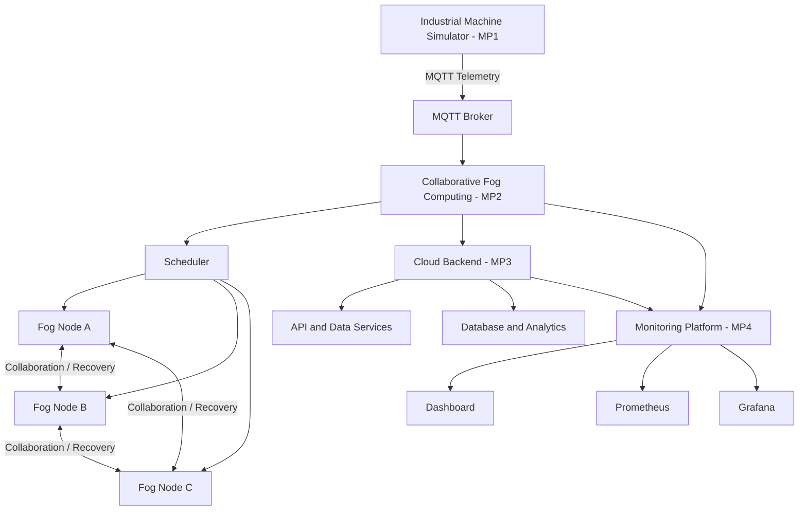
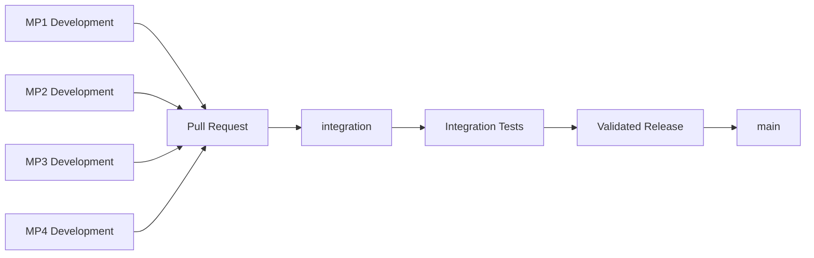
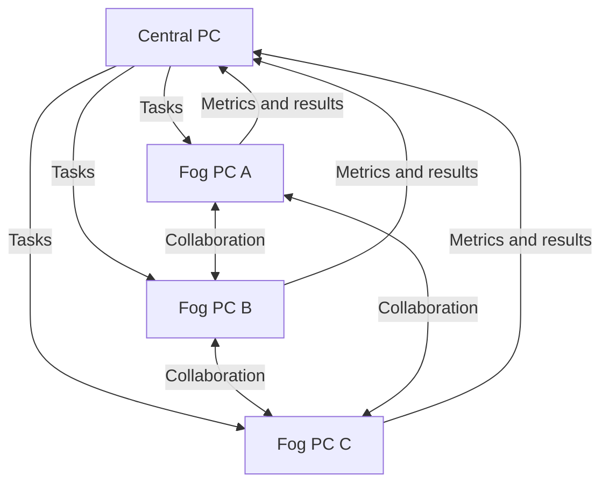

# Real-Time Predictive Maintenance Platform

**Distributed Industrial IoT · Edge/Fog Computing · Machine Learning · Cloud Backend · Monitoring**

An end-to-end distributed predictive maintenance platform designed to simulate industrial equipment, analyze machine telemetry, detect potential failures, distribute processing across Fog nodes, centralize operational data, and monitor the complete system.

---

## 1. Project Overview

Industrial equipment failures can lead to production interruptions, increased maintenance costs, and reduced operational efficiency.

This project explores a distributed predictive maintenance architecture combining Industrial IoT simulation, AI-based prediction, Collaborative Fog Computing, cloud-side backend services, and monitoring.

The platform is developed as four complementary mini-projects that are progressively integrated into one system.

### Objectives

- Simulate industrial machines and their telemetry.
- Generate and analyze sensor data in real time.
- Apply predictive maintenance and anomaly-detection techniques.
- Distribute tasks across multiple Fog nodes.
- Collaborate between Fog nodes to improve processing availability.
- Centralize events, operational data, analytics, and APIs.
- Monitor system health, metrics, and infrastructure.
- Prepare a distributed deployment across multiple physical computers.

---

## 2. System Architecture



### Data Flow

1. The industrial simulator generates machine telemetry and events.
2. MQTT transports telemetry to the distributed processing architecture.
3. The Scheduler selects an appropriate Fog node.
4. Fog nodes process tasks locally and collaborate when required.
5. Results and operational information are communicated to backend services.
6. Backend services store and expose data through APIs and analytics.
7. Monitoring components collect metrics and display system status.

---

## 3. Mini-Projects

| Component | Description | Main Technologies |
|---|---|---|
| MP1 — Industrial Simulation & Predictive Maintenance | Industrial machine simulation, telemetry generation, feature engineering, failure detection and prediction | Python, Machine Learning, MQTT |
| MP2 — Collaborative Fog Computing | Distributed task processing, scheduling, Fog-node collaboration, recovery and resilience | Python, FastAPI, MQTT, Docker |
| MP3 — Cloud Backend | Centralized APIs, data persistence, operational analytics, supervision and backend services | Python, FastAPI, PostgreSQL, MQTT, Docker |
| MP4 — Monitoring Dashboard | System visualization, monitoring dashboards, metrics and infrastructure observability | React, TypeScript, Vite, Prometheus, Grafana |

Each mini-project has a dedicated development branch. The integration branch combines their work into the complete platform.

---

## 4. Repository Structure

The integration branch contains both the original module locations and a consolidated layout. The consolidated layout is the navigation target for new work; legacy locations remain while their contents and local changes are reconciled.

```text
.
├── projects/
│   ├── mp1/ (simulator, industrial simulation assets)
│   ├── mp2/ (Fog nodes, scheduler, MQTT and tests)
│   ├── mp3/ (contracts and FastAPI cloud backend)
│   └── mp4/ (dashboard, Prometheus and Grafana)
├── deployment/lot4/ (core, automation, alternative-deployment)
├── archive/lot4/ (superseded deployment variants retained for reference)
├── docs/ (cross-project specifications and guides)
└── .github/workflows/ (CI workflows)
```

Module entry points are documented in `projects/mpN/README.md` and `deployment/lot4/README.md`. Older root-level module folders remain during reconciliation; use the consolidated paths for new work.
## 5. Technology Stack

### Industrial IoT and Simulation
- Python
- MQTT
- Synthetic industrial telemetry
- Predictive maintenance and machine-learning components

### Fog Computing
- Python
- FastAPI
- MQTT
- Docker and Docker Compose
- Distributed task scheduling
- Fog-node monitoring and recovery

### Backend
- FastAPI
- PostgreSQL
- MQTT-based services
- REST APIs
- Analytics and data management

### Monitoring and Visualization
- React
- TypeScript
- Vite
- Prometheus
- Grafana
- Docker

---

## 6. Development Environment

### Prerequisites

Install the following tools before running the platform:

- Git
- Python 3.12 or compatible version
- Docker
- Docker Compose
- Node.js and npm (for the monitoring frontend)
- MQTT broker (Mosquitto or the project's configured broker)

Verify installations:

```bash
git --version
python --version
docker --version
docker compose version
node --version
npm --version
```

---

## 7. Getting Started

### Clone the repository

```bash
git clone https://github.com/Mahmoud5777/Real-Time-Predictive-Maintenance.git
cd Real-Time-Predictive-Maintenance
```

### Select the integration branch

```bash
git checkout integration
git pull origin integration
```

### Run a mini-project

Each mini-project has its own setup, configuration, and execution instructions.

Refer to the documentation and configuration files in the corresponding component directory before launching its services.

#### MP1 — Industrial Simulation

Location: `projects/mp1/simulator/` (supporting industrial assets: `projects/mp1/industrial-simulation/`). See the module README for package-specific setup and commands.

#### MP2 — Collaborative Fog Computing

Location: `projects/mp2/`. See its README for the local compose topology and test command.

#### MP3 — Cloud Backend

Location: `projects/mp3/`; the FastAPI service is under `mp3-cloud/`. See its README and backend README for configuration, migrations, and tests.

#### MP4 — Monitoring

Location: `projects/mp4/`; the frontend is under `frontend/`. See the frontend README for npm commands.
> Service startup commands, environment variables, ports, and deployment configurations are maintained in the individual mini-projects and their documentation.

---

## 8. Git Workflow

The project uses a branch-based workflow to separate development from integration and stable releases.

### Branch Strategy

| Branch | Purpose |
|---|---|
| `main` | Stable, validated project version |
| `integration` | Integration and cross-component validation |
| `mp1-industrial-simulation` | MP1 development |
| `mp2-collaborative-fog` | MP2 development |
| `mp3-cloud-backend` | MP3 development |
| `mp4-monitoring-dashboard` | MP4 development |

### Workflow



### Development Process

1. Develop features in the corresponding mini-project branch.
2. Commit validated changes.
3. Push the development branch to GitHub.
4. Create a Pull Request toward `integration`.
5. Validate the integrated platform.
6. Merge validated integration work into `main` when a stable release is ready.

### Useful Git Commands

```bash
# Update integration
git checkout integration
git pull origin integration

# Switch to a mini-project branch
git checkout mp2-collaborative-fog

# Commit a validated change
git add .
git commit -m "feat(mp2): describe the implemented feature"

# Push the branch
git push
```

---

## 9. Testing and Validation

Validation is performed at different levels:

- Unit tests for individual modules.
- Component tests for each mini-project.
- Integration tests for communication between components.
- Fault and recovery scenarios for Fog nodes.
- Monitoring validation.
- Deployment validation in the target environment.

Tests should be executed using the instructions and test configuration of the component being validated.

---

## 10. Distributed Deployment — Target Architecture

The platform is being prepared for deployment across four physical computers.

### Planned topology

| Computer | Role |
|---|---|
| Central PC | Simulator, MQTT infrastructure, Scheduler, backend, dashboard and centralized monitoring |
| Fog PC A | Fog Node A — Zone A |
| Fog PC B | Fog Node B — Zone B |
| Fog PC C | Fog Node C — Zone C |

### Target Deployment Flow



The physical deployment phase will include:

- Network connectivity between computers.
- Static or reserved IP addresses.
- MQTT connectivity over the local network.
- Remote Scheduler-to-Fog communication.
- Distributed service configuration.
- Firewall configuration.
- Monitoring of remote nodes.
- Deployment and recovery procedures.

The distributed physical deployment is a target phase and should not be considered complete until it has been validated on the actual computers.

---

## 11. Monitoring and Observability

The monitoring component is designed to provide visibility into the operational state of the platform.

Monitoring objectives include:

- Fog-node availability.
- Scheduler availability.
- Task processing activity.
- Processing and response times.
- System resource usage.
- Failure and recovery events.
- Backend service health.
- Operational metrics and dashboard visualization.

Prometheus and Grafana are used within the monitoring stack, together with the project's dashboard interface.

---

## 12. Project Status

| Area | Status |
|---|---|
| MP1 — Industrial Simulation | Developed and integrated |
| MP2 — Collaborative Fog Computing | Developed and integrated |
| MP3 — Cloud Backend | Developed and integrated |
| MP4 — Monitoring Dashboard | Developed and integrated |
| Git branch organization | Established |
| Integration branch | Active |
| Stable main branch | Maintained |
| Physical multi-PC deployment | Planned validation phase |

Project status may evolve as integration, testing, and physical deployment progress.

---

## 13. Future Improvements

- Complete physical deployment on the four PCs.
- Validate distributed task execution over the local network.
- Improve fault tolerance and recovery scenarios.
- Validate end-to-end telemetry and backend integration.
- Improve observability and operational dashboards.
- Automate deployment and configuration.
- Strengthen integration testing and CI/CD workflows.
- Document deployment and troubleshooting procedures.

---

## 14. Academic Project

This repository contains the development of a distributed predictive maintenance platform combining industrial simulation, AI-based processing, Collaborative Fog Computing, backend services, and monitoring.

The project is organized into multiple mini-projects that are progressively integrated into a complete system.

---

## Repository

GitHub: [Mahmoud5777/Real-Time-Predictive-Maintenance](https://github.com/Mahmoud5777/Real-Time-Predictive-Maintenance)

**Development branch:** `integration`  
**Stable branch:** `main`
