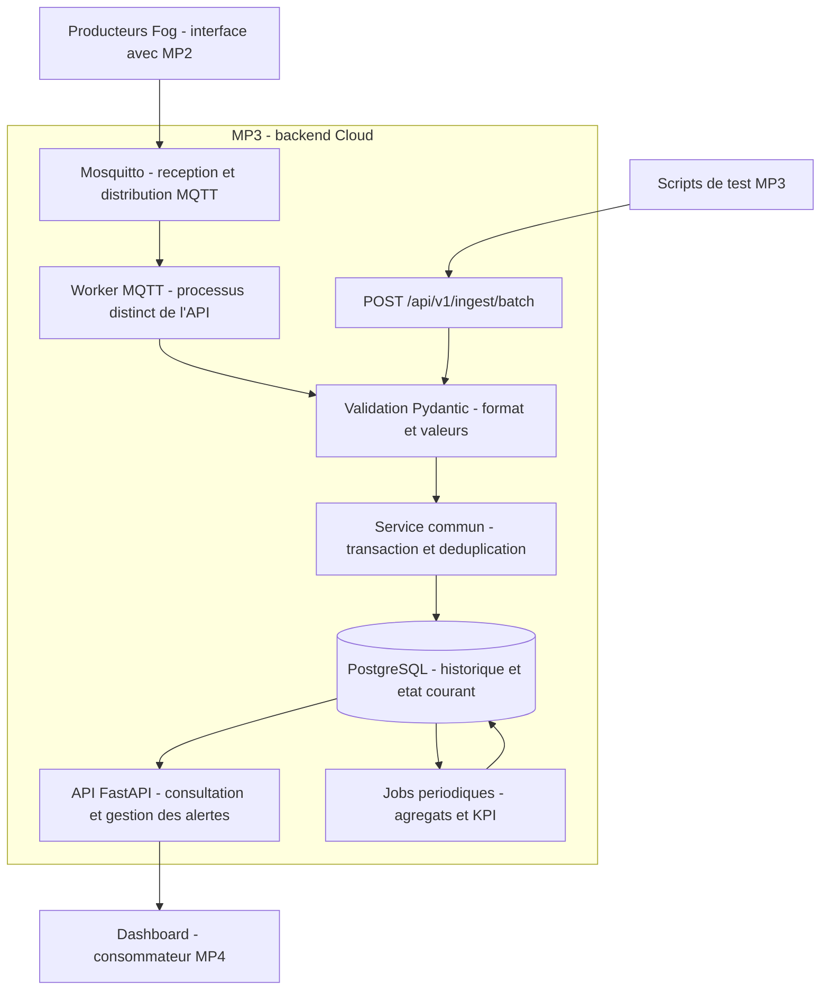

# Architecture vue depuis MP3

> Perimetre de travail : MP3 uniquement. Les schemas ci-dessous decrivent la cible.
> L'etat effectivement verifie et le parcours pas a pas figurent en fin de document,
> dans « Etape 1 realisee » a « Etape 8 realisee ». L'instantane du 1 novembre reste
> conserve pour comprendre le point de depart. Les entrees HTTP et MQTT utilisent maintenant
> le meme service d'ecriture PostgreSQL ; lectures, KPI, supervision et retention sont livres.

Je ne possede que la couche Cloud. Ce document decrit ce qui entre et ce qui sort de mon
perimetre, afin qu aucun autre module n ait a deviner mes hypotheses.

## Exigence de presentation rapportee par l'utilisateur

La prof veut voir trois noeuds Fog fonctionner comme trois VM : trois environnements
d'execution distincts, actifs simultanement, chacun assurant son traitement et communiquant
avec les autres Fog. Cette exigence de demonstration a ete communiquee par l'utilisateur ;
elle complete le cahier des charges.

Pour MP3, FOG_A, FOG_B et FOG_C doivent etre identifies separement dans les messages,
les etats et les heartbeats. L'API doit permettre de consulter l'activite de chaque noeud
et les evenements de collaboration recus, afin de fournir les donnees utiles a la demonstration.
La mise en place des environnements Fog et leur collaboration relevent de MP2.
Le choix concret de virtualisation devra respecter cette demonstration de trois noeuds
independants et interconnectes.

Priorite demandee par l'utilisateur : valoriser le partage entre les Fog, la gestion des
taches et la charge. MP3 doit conserver les observations et la chronologie necessaires
pour rendre ces mecanismes visibles et comparer leurs effets sur les performances.
L'etape 2, dans [TASKS.md](../mp3-cloud/TASKS.md), ajoute un registre des taches et un historique
de charge aux sept tables du socle. Les neuf tables sont creees et verifiees ; leurs champs
et relations sont expliques dans [DATABASE_SCHEMA.md](../mp3-cloud/docs/DATABASE_SCHEMA.md).

## Position dans la chaine

```
MP1 simulateur  ->  MP2 nœuds Fog  ->  [ MP3 : ce depot ]  ->  MP4 dashboard
   (hors ici)        (hors ici)      ingestion + base + API     (hors ici)
```

Les fleches entrantes et sortantes sont des **contrats**, pas du code partage :
`docs/DATA_CONTRACT.md` (ce qu on m envoie) et `contracts/openapi.yaml` (ce que je fournis).

## Interne a MP3

```
Mosquitto (topics fog/+/predictions, /alerts, /status, tasks/events)
        |
        v
app/ingest/worker.py ......... consommateur MQTT (T5)
        |
        v
app/services/ingest.py ....... validation Pydantic + dedup par message_id (T4/T6)
        |                       ^
        |                       | POST /api/v1/ingest/batch (T7, secours + seed + tests)
        v
PostgreSQL ................... machines, sensor_data, predictions, alerts,
                               fog_nodes, fog_status_history, tasks, task_events,
                               kpi_records (T3)
        |
        v
app/api/* .................... lecture paginee + analytics + KPI (T8/T9)
        |
        +-- /healthz          supervision
        +-- /metrics          Prometheus
        +-- /api/v1/stream    SSE temps reel (bonus B1)
```

Un seul pipeline d ecriture pour MQTT et HTTP : c est ce qui empeche deux comportements
divergents selon le transport.

## Frontieres de responsabilite

| Couche | Possede | Ne fait pas |
|---|---|---|
| MP1 | generation de donnees, modele ML | decisions de routage |
| MP2 | analyse temps reel, scheduling, tolerance aux pannes | stockage historique |
| **MP3** | verite des donnees, API, historique, KPI | calcul temps reel critique |
| MP4 | visualisation, observabilite, deploiement | acces direct a ma base ou a mes topics |

Regles que j applique et que je fais respecter :
- Si mon API tombe, l usine doit continuer a alerter : la detection critique reste chez MP2.
- MP4 ne lit jamais PostgreSQL ni les topics : il passe par mon API. Sinon mes KPI ne sont plus
  la source unique et toute contradiction devient impossible a tracer.

## Volumetrie qui justifie mes choix

12 machines x 1 mesure/s representent un volume theorique de ~1,04 M lignes/jour.
Le schema initial utilise des index et des tables non partitionnees. La retention brute,
les agregats horaires, les ecritures groupees et un eventuel partitionnement seront verifies
lors du jalon de performance. Le choix de partitionnement devra rester compatible avec
l'unicite des identifiants de message ; le gain sera mesure sur la charge reelle.

## Latences cibles mesurees par moi

| Evenement | Objectif | Ou je le mesure |
|---|---|---|
| Reception MQTT -> ligne en base | < 250 ms | histogramme ingestion |
| Alerte recue -> visible via API | < 500 ms | metrique `/api/v1/alerts?status=OPEN` |
| Requete d historique paginee | p95 < 150 ms | test de charge T12 |
| Calcul d un KPI horaire | < 5 s | log du job + `computed_at` |

## Architecture cible expliquee



Mosquitto est le courtier de messages : il transporte les messages, mais ne remplace pas
l'historique PostgreSQL. Le worker et la route HTTP doivent utiliser le meme service
d'ecriture. Un message valide est enregistre dans une transaction ; une nouvelle livraison
du meme message ne doit pas creer un doublon. L'API de lecture consulte les donnees
enregistrees. Les jobs calculent les statistiques et stockent leurs resultats dans kpi_records.

Les quatre services declares dans docker-compose.yml sont :

- db : PostgreSQL 16, stockage durable dans le volume pgdata.
- mosquitto : courtier MQTT, port 1883.
- api : application FastAPI, port 8000.
- ingest : worker MQTT utilisant le meme code et la meme configuration que l'API.

Le service ingest est declare mais son programme est encore a implementer. Les jobs KPI
ne disposent pas encore d'un processus configure dans Compose.

Les modeles definissent neuf tables :

- machines : catalogue des equipements et rattachement a une zone / un Fog.
- sensor_data : mesures horodatees des machines.
- predictions : resultats ML recus, risques, anomalies et version du modele.
- alerts : alertes et leur cycle OPEN -> ACKNOWLEDGED -> RESOLVED.
- fog_nodes : dernier etat connu et dernier heartbeat des noeuds.
- fog_status_history : observations successives de charge, etat et files d'attente.
- tasks : dernier etat et affectation connus, avec origine preservee.
- task_events : historique des evenements de creation, migration et reprise de taches.
- kpi_records : statistiques calculees pour une periode et un perimetre.

Le code est organise par responsabilite :

- app/main.py et app/config.py : application et configuration.
- app/api/ : routes HTTP.
- app/schemas/ : messages Pydantic et conventions communes.
- app/services/ : logique metier partagee.
- app/ingest/ : consommateur MQTT.
- app/models/ et app/db/ : modeles SQLAlchemy et sessions PostgreSQL.
- alembic/ : gestion des versions du schema.
- scripts/ et tests/ : exemples de donnees et verification.
- contracts/ et docs/DATA_CONTRACT.md : interfaces avec les producteurs et le dashboard.

## Etat verifie au 1 novembre 2026

Verification effectuee sur ce poste, sans demarrer de services ni installer de dependances.
Le resultat constitue un instantane : l'etat des services peut changer apres cette verification.

### Fonctionnel dans les verifications locales

- 14 tests existants passent avec Python 3.13.2 et les bibliotheques actuellement installees.
- Ruff ne signale aucune erreur.
- Les 5 fixtures valides sont acceptees et les 5 fixtures invalides sont rejetees.
- L'authentification de l'ingestion et les reponses HTTP par element sont testees.
- /healthz et /metrics repondent dans le client de test FastAPI.
- Les routes machines, detail machine et derniere mesure sont codees ; leur execution
  contre PostgreSQL n'a pas ete validee, car la base n'est pas accessible.

Ces tests couvrent la validation et une partie de l'API. Ils ne prouvent pas encore une
chaine MQTT -> PostgreSQL -> API operationnelle.

### Prepare mais incomplet

- Les sept modeles SQLAlchemy et la connexion asynchrone sont presents.
- Alembic est configure, mais alembic/versions ne contient aucune migration Python.
- La route HTTP compte actuellement les messages valides comme accepted, sans les
  inserer en base. Le compteur duplicates n'est pas encore alimente par PostgreSQL.
- Le worker MQTT leve NotImplementedError.
- Les routes d'historique, predictions, alertes, etat Fog, taches et analytics du contrat
  OpenAPI ne sont pas encore implementees.
- Les calculs KPI, la retention, le partitionnement et le flux SSE restent a construire.
- Aucun workflow CI n'est present dans l'espace de travail actuel.
- Les contrats existent ; leur validation par les autres membres n'est pas verifiable ici.

### Environnement local

- Le client Docker 29.7.2 et Docker Compose 5.5.1 sont installes.
- Le moteur du contexte desktop-linux est inaccessible : le canal du moteur Docker
  n'existe pas lors du controle. Les conteneurs ne peuvent donc pas etre verifies.
- Aucun service ne repond sur les ports locaux 5432, 1883 et 8000.
- Aucun fichier .env n'est present a la racine ou dans mp3-cloud.
- Aucun environnement virtuel Python n'est present a la racine ou dans mp3-cloud.
- Python 3.13.2 et la plupart des bibliotheques sont installes globalement, mais leurs
  versions different des versions figees dans requirements.txt et requirements-dev.txt.
  aiosqlite et locust ne sont pas installes dans ce Python.
- Le Dockerfile cible Python 3.12 : l'environnement local devra etre aligne et isole.

Conclusion : les fichiers d'environnement sont prepares, mais le poste n'est pas encore
configure pour une execution reproductible de l'ensemble de MP3.

### Corrections de configuration identifiees

Le chargement de .env.example avec Settings echoue sur cors_origins. La variable
CORS_ORIGINS doit contenir un tableau JSON, par exemple :

```dotenv
CORS_ORIGINS=["http://localhost:3000","http://localhost:5173"]
```

Les adresses dependent du lieu d'execution :

- API sur Windows, PostgreSQL/MQTT exposes par Docker : localhost et les ports publies.
- API et worker dans Compose : serveur PostgreSQL db, serveur MQTT mosquitto.

Le fichier Compose actuel n'applique pas ces substitutions a DATABASE_URL et MQTT_HOST.
Copier .env.example sans corriger ces points ne fournit donc pas un demarrage valide de
l'ensemble des conteneurs.

Le health check /healthz actuel renvoie une reponse fixe. Son succes ne prouve pas que
PostgreSQL est connecte ou que les tables existent.

## Parcours MP3 pas a pas

Une etape est consideree terminee seulement lorsque sa verification est obtenue.
Les modifications seront limitees au perimetre MP3 et a ses contrats.

1. **Rendre l'environnement reproductible.**
   Comprendre la difference entre logiciel installe, conteneur demarre et service pret.
   Demarrer le moteur Docker, creer la configuration locale corrigee, isoler Python et
   installer les dependances figees. Choisir clairement API locale ou API dans Docker.
   Verification : PostgreSQL accepte une requete, Mosquitto transporte un message de test,
   et l'API demarre avec sa configuration. Une reponse /healthz seule ne suffit pas.

2. **Creer et comprendre la base de donnees.**
   Relier chaque message a sa table, harmoniser les champs du contrat et des modeles,
   definir les cles et index, puis ecrire la migration initiale Alembic.
   La longueur de message_id et les contraintes de deduplication doivent etre compatibles
   avec le schema et avec le partitionnement eventuel.
   Peupler le catalogue M01 a M12 avant d'inserer des mesures avec une cle etrangere.
   Verification : migration rejouable sur une base vide, neuf tables metier et catalogues presents.

3. **Terminer le service d'ecriture avec l'entree HTTP.**
   Comprendre validation, transaction et idempotence. Inserer les messages valides,
   traiter les etats Fog, rejeter les donnees incoherentes et compter les doublons.
   Verification : un lot HTTP apparait en base ; envoyer trois fois un meme message
   ne cree qu'un seul enregistrement ; les erreurs restent identifiables par element.

4. **Brancher MQTT sur le meme service.**
   Implementer abonnement, correspondance topic/type, traitement et reconnexion.
   Definir le comportement d'acquittement et de reprise apres une erreur de base.
   Verification : un message MQTT arrive en base puis devient consultable par l'API ;
   une nouvelle livraison du meme message est dedupliquee.

5. **Completer les API utiles au dashboard.**
   Ajouter historique, predictions, alertes, etat Fog et evenements de taches.
   Uniformiser pagination, filtres, tri, erreurs et protection des actions d'ecriture.
   Verification : chaque route livree correspond au contrat OpenAPI et fonctionne sur
   des donnees PostgreSQL de demonstration.

6. **Construire les premiers KPI et les agregats.**
   Commencer par les indicateurs directement observables : alertes critiques,
   risques des machines, migrations et volumes d'ingestion.
   Definir fenetre, formule, unite et taille d'echantillon avant le calcul.
   La precision ML exige une verite terrain supplementaire ; la disponibilite exige
   un historique temporel des etats, pas seulement le dernier etat de fog_nodes.
   Verification : valeurs connues sur un jeu de donnees controle et recalcul sans doublon.

7. **Valider la robustesse et automatiser les controles.**
   Ajouter les tests PostgreSQL et MQTT, les scenarios de panne/reconnexion et les
   verifications de conformite. Mettre en place une CI dediee a MP3.
   Verification : installation et tests reproductibles depuis un clone propre.

8. **Mesurer et preparer la livraison.**
   Mesurer les latences et le volume reel, puis valider retention, index,
   partitionnement et ecritures groupees selon les besoins observes.
   Documenter le demarrage, les limites, les contrats et une demonstration autonome MP3.
   Verification : rapport de mesures et scenario reproductible
   message -> base -> API -> KPI.

Les etapes suivantes s'appuient chacune sur une preuve simple obtenue a l'etape precedente.
Les validations realisees sont indiquees ci-dessous.

## Etape 1 realisee - environnement local valide

Cette validation actualise l'etat de l'environnement de l'instantane initial ci-dessus.
Le mode retenu est PostgreSQL et Mosquitto dans Docker, avec l'API sur Windows dans
l'environnement Python 3.13.2 dedie a MP3.

- .env cree avec les adresses locales et CORS_ORIGINS au format JSON.
- .venv cree et dependances de requirements-dev.txt installees.
- pip check : aucune dependance incompatible.
- Tests : 14 tests reussis dans .venv ; avertissements de deprecation et de cache
  sans echec de test.
- Ruff : aucune erreur ; 10 fixtures de contrat conformes aux resultats attendus.
- Conteneurs db et mosquitto demarres ; volume PostgreSQL pgdata cree.
- Requete PostgreSQL depuis le conteneur et depuis Python sur Windows :
  current_database() renvoie fog_cloud.
- Publication et reception MQTT de hello-mp3 sur mp3/test verifiees,
  dans le conteneur et depuis Python sur Windows.
- API demarree avec Uvicorn sur http://127.0.0.1:8000.
- /healthz, /docs et /openapi.json : reponses HTTP 200 verifiees.
- .env et .venv sont exclus de Git par les regles existantes.

L'environnement de l'etape 1 est pret. La creation de la base est realisee dans l'etape 2
ci-dessous ; l'ingestion et les API de donnees restent les jalons suivants.

## Etape 2 realisee - schema et catalogues verifies le 2 novembre 2026

- Neuf tables metier et table technique alembic_version dans fog_cloud.
- Revision appliquee : 0001_mp3_schema ; upgrade head rejoue et alembic check sans modification.
- Trois Fog initialises : FOG_A / A, FOG_B / B, FOG_C / C.
- Douze machines : M01-M04 en A, M05-M08 en B, M09-M12 en C ; references Fog verifiees.
- Seconde initialisation : zero ajout. Les etats observes et metadonnees existants sont preserves.
- Fog OFFLINE, charge / heartbeat absents ; types de machine UNSPECIFIED et date d'installation
  inconnue jusqu'a reception des vraies metadonnees.
- Bornes numeriques, etats autorises, UUIDv4, unicite des messages et cles etrangeres verifies.
- Origine connue d'une tache protegee contre les modifications ; affectation courante distincte.
- Scenarios de charge, partage A -> B, localite critique et reprise sur un autre Fog verifies
  par insertion de donnees de test dans une base PostgreSQL jetable.
- Upgrade / downgrade / upgrade verifie dans cette base jetable, ensuite supprimee.
- 79 tests reussis avec --postgres (20 tests locaux et 59 PostgreSQL), Ruff valide et
  11 fixtures conformes. Un avertissement de deprecation de Starlette / AnyIO subsiste.
- API locale : /api/v1/machines renvoie les douze machines ; detail M01 et /healthz repondent.

Ces tests prouvent que le schema peut conserver les observations de collaboration. Le
catalogue ne constitue pas la demonstration des trois VM : MP2 devra faire fonctionner
les trois environnements et fournir leurs messages reels. Aucune amelioration de performance
du partage n'est encore mesuree.

Lors de cette verification de l'etape 2, la route HTTP ne persistait pas encore les messages.
L'etape 3 ci-dessous realise l'ecriture et les projections, puis l'etape 4 ajoute le worker MQTT.
La supervision et les calculs KPI restent a construire. Les extensions de chronologie restent a convenir.

## Etape 3 realisee - ingestion HTTP verifiee le 2 novembre 2026

Le service commun `persist_batch` enregistre mesures, predictions, alertes, observations
Fog et evenements de taches. Une transaction couvre le lot et un savepoint chaque message.
Le bilan n'est renvoye qu'apres commit. Les doublons sont sans effet et les conflits de
contenu ou de references sont identifies par element.

Les historiques et projections sont atomiques. Un ancien heartbeat ne remplace pas le
dernier etat. L'origine d'une tache reste conservee ; une creation tardive ne remplace pas
une affectation observee. Les limites de chronologie et les protections terminales sont
detaillees dans [HTTP_INGESTION.md](../mp3-cloud/docs/HTTP_INGESTION.md).

- 114 tests reussis avec --postgres, dont les tests d'etape 2 conserves.
- Les tests HTTP reels confirment le commit depuis une autre connexion et le rejeu.
- Les tests locaux HTTP n'ont aucune connexion a la base de travail.
- Les tests multi-connexions utilisent une base jetable distincte.
- Le schema reste a la revision 0001_mp3_schema ; aucune migration nouvelle.
- Les tests utilisent des observations synthetiques ; aucun heartbeat reel n'est invente.

Le contrat HTTP precise 207 pour les doublons seuls, 422 pour un rejet total et 503 pour
une transaction non confirmee. L'etape suivante a ce jalon etait 4, realisee ci-dessous.

## Etape 4 realisee - ingestion MQTT verifiee le 2 novembre 2026

Le worker autonome recoit mesures, predictions, alertes, heartbeats et evenements de taches.
Il construit l'enveloppe interne puis appelle `persist_batch`. Les ACK QoS 1 suivent le commit
ou un rejet definitif consigne ; une panne temporaire de stockage est retentee sans ACK.
Les retransmissions sont absorbees par la deduplication de l'etape 3.

- 149 tests reussis avec --mqtt, dont les tests HTTP et PostgreSQL des jalons precedents.
- Les tests reels couvrent reconnexion, panne DB, commit sans ACK, session persistante,
  broker redemarre, heartbeat retenu et file pleine. Trois publications identiques donnent
  une ligne et deux doublons. Les cinq types deviennent consultables par les routes existantes.
- File et payload bornes, retries croissants, demarrage conditionne au schema/catalogue,
  metriques propres au worker et arret SIGTERM.
- Compose applique les adresses internes db / mosquitto et un volume mqttdata persistant.
- Sur ce poste, ingest est healthy, connected=1 et ready=1 sur le port 8001. L'API Windows
  reste active sur le port 8000 ; Mosquitto sauvegarde son etat dans mqttdata.
- Le schema reste 0001_mp3_schema. Les messages producteurs gardent leurs champs actuels.
- Les tests utilisent des bases et brokers jetables. Aucune observation synthetique n'est
  ajoutee a la base de travail ; les catalogues ne prouvent pas l'activite des Fog reels.

Le guide [MQTT_INGESTION.md](../mp3-cloud/docs/MQTT_INGESTION.md) detaille lancement,
publication manuelle, metriques et limites de reprise. Le broker sauvegarde periodiquement
ses sessions ; les producteurs doivent aussi tamponner leurs messages lorsqu'il est inaccessible.
Les rejets n'ont pas encore de quarantaine durable. L'etape 5 est realisee ci-dessous ;
la supervision persistante des Fog et les jobs KPI restent a implementer.

## Etape 5 realisee - lectures verifiees le 7 novembre 2026

Les 13 GET metier couvrent catalogue, derniere mesure, historiques de mesures et de charge,
predictions, alertes, etats Fog, projections des taches et journal. Les huit collections
renvoient items/meta, des pages bornees, des filtres valides et un tri par cle primaire
pour les egalites. Les dates inconnues restent NULL et les bornes temporelles sont UTC.

La zone d'une prediction ou alerte vient de sa machine, distincte du Fog executant.
La zone d'une tache ou de ses evenements vient de l'origine connue. Le journal distingue
creation, reception Cloud et date d'evenement connue. La lecture Fog expose l'age et le
caractere stale du heartbeat, en conservant le statut rapporte sans inventer une panne.

Les lectures restent publiques dans l'environnement de demonstration. L'ingestion conserve
son token, maintenant declare dans Swagger. Les 404 / 503 des lectures ont un Problem au
premier niveau ; les 422 conservent le format de validation FastAPI.

- 247 tests reussis avec --mqtt, dont les 149 precedents et 98 nouveaux controles de lecture.
- Reponses PostgreSQL validees contre les schemas OpenAPI 3.0 publies.
- Contrat des GET synchronise avec FastAPI et valide ; routes futures marquees planned.
- Ruff valide, 11 fixtures conformes, Compose valide, aucune migration supplementaire.
- Donnees de verification exclusivement dans des bases / brokers jetables.
- API Docker Python 3.12 construite et demarree ; les 13 lectures et Swagger verifies par HTTP.
- Base de travail preservee : 12 machines, 3 Fog, aucune observation synthetique ; ressources de test nettoyees.

Le guide [READ_API.md](../mp3-cloud/docs/READ_API.md) detaille les routes, erreurs et limites
de pagination sous ingestion concurrente. L'etape 6 est realisee ci-dessous.

## Etape 6 realisee - analytics verifies le 7 novembre 2026

Le processus Docker analytics agrege les observations en SQL sur les heures UTC terminees.
Les 21 indicateurs vivent dans kpi_records ; quatre GET analytics lisent le cache,
avec unites, effectifs, dates source et fraicheur. Les dimensions zone, machine, Fog
et modele sont independantes. Les rapports de taches utilisent received_at jusqu'a
fourniture de dates d'evenement ; le MTTR d'alertes utilise la cohorte de resolutions.

Chaque refresh possede une transaction REPEATABLE READ et un verrou advisory non bloquant.
Les seules metriques du module sont remplacees atomiquement. Timeout ou annulation
conserve l'ancien cache. Le lookback est borne par la retention declaree ; l'ancien
cache reste disponible. Aucune purge automatique n'est introduite.

La migration 0002_kpi_scope permet les versions de modele de 64 caracteres et indexe
receptions de taches / resolutions critiques, avec toujours neuf tables metier.
La precision ML, la disponibilite, le MTBF et les temps de reprise restent indisponibles
en l'absence de labels, transitions completes et chronologies de tentatives.

- 316 tests reussis avec --mqtt, dont 69 nouveaux controles analytics.
- Ruff, 11 fixtures, contrat OpenAPI 3.0.3 et Compose valides.
- API et analytics construits sous Python 3.12 ; quatre GET verifies et analytics healthy.
- Le worker a attendu le schema puis confirme son refresh ; metriques sur le port 8002.
- Base de travail sans observation synthetique ; tests dans des bases et brokers jetables.

Le guide [KPI_FORMULAS.md](../mp3-cloud/docs/KPI_FORMULAS.md) detaille calculs, limites
et reprise. La supervision persistante est realisee ci-dessous ; retention et
performance restent a implementer/mesurer.

## Etape 7 realisee - supervision verifiee le 7 novembre 2026

Le worker supervision verifie date producteur et reception Cloud des heartbeats.
Il conserve decisions UNKNOWN / REACHABLE / UNREACHABLE et raisons dans les tables
existantes, sans modifier le statut MP2. Les verrous sont partages avec l'ingestion,
les transactions sont bornees et les reprises apres erreur utilisent des sessions neuves.
Les lacunes de scan sont UNKNOWN / MONITOR_GAP avec bornes ; aucune panne reelle n'est
reconstruite dans une periode inconnue. Les anciens messages et doublons ne reactivent
pas un noeud silencieux ; les erreurs d'horloge sont explicites.

La migration 0003_fog_supervision conserve neuf tables metier et distingue HEARTBEAT
de SUPERVISION par CHECK, avec refus de downgrade effacant des preuves Cloud.
Les lectures conservent l'historique producteur et ajoutent /fog/supervision-history,
fraicheur et etat effectif. Le calcul de disponibilite reelle reste indisponible.

- 364 tests reussis avec --mqtt, dont les 316 precedents et 48 controles supplementaires.
- Ruff, 11 fixtures, contrat OpenAPI et Compose valides ; metadata Alembic conforme.
- Images Python 3.12 construites, workers ingestion / analytics / supervision healthy.
- Supervision ready=1 sur 8003 ; trois Fog UNKNOWN sans faux heartbeat ni panne inventee.

Le guide [FOG_SUPERVISION.md](../mp3-cloud/docs/FOG_SUPERVISION.md) donne les seuils,
limites et commandes. La retention est realisee ci-dessous avec preservation de la
deduplication et des preuves d'alertes, KPI et chronologies.

## Etape 8 realisee - retention verifiee le 7 novembre 2026

Le worker retention finalise les quinze agregrats horaires de mesures/predictions
avant suppression des bruts expires. Une marque technique fige l'heure et interdit
un recalcul sur une source partiellement ou entierement supprimee. Les nouvelles
observations d'une heure finalisee sont refusees ; les doublons connus restent reconnus.
Ingestion et purge utilisent une barriere partagee/exclusive et un commit atomique.

Le registre technique ingest_receipts conserve kind/message_id et empreinte SHA-256.
Il complete les neuf tables metier, avec alembic_version : onze tables PostgreSQL.
La migration 0004 refuse un downgrade perdant les preuves de bruts deja expires.
Le dernier capteur, alertes, taches et historique Fog restent conserves. Les lots
suivants utilisent le cache complet et ne recalculent pas une moyenne du brut restant.

- 385 tests reussis avec --mqtt, dont 21 nouveaux ; 27 controles de base apres le garde-fou final.
- Ruff, 11 fixtures, OpenAPI et Compose valides ; metadata Alembic conforme.
- Images Python 3.12 construites ; retention, ingestion, analytics et supervision healthy.
- Retention dry_run=1 sur 8004, candidats=0 ; aucune donnee de travail supprimee.

Le guide [RETENTION.md](../mp3-cloud/docs/RETENTION.md) explique perimetre, admission
des messages expires, activation et limites de stockage. La mesure des performances
et de la contention precede les futures optimisations ou partitions.
