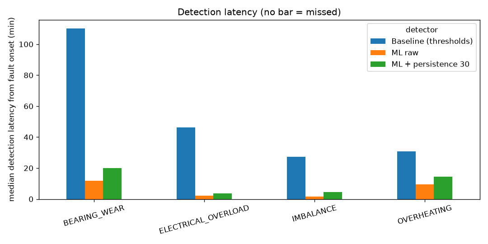
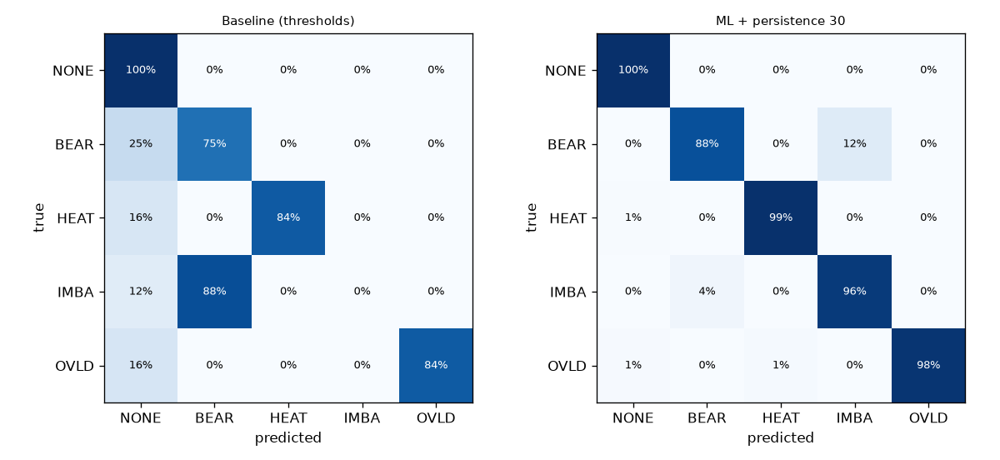

# MP1 evaluation report

Model `hybrid-2026-11-18` trained on seed 42 (train set). Evaluated on the test scenarios
with 5 unseen seeds [7, 11, 23, 31, 47]; values are mean ± std over seeds.
Alarm persistence for the ML detector: 30 consecutive samples (1 Hz).

## 1. Per-sample detection quality
| detector | precision | recall | F1 | false-alarm rate (%) | false alarms / machine-day |
|---|---|---|---|---|---|
| Baseline (thresholds) | 1.0 ± 0.0 | 0.829 ± 0.015 | 0.906 ± 0.009 | 0.0 ± 0.0 | 0.0 ± 0.0 |
| ML raw | 0.998 ± 0.001 | 0.999 ± 0.002 | 0.998 ± 0.001 | 0.104 ± 0.039 | 52.76 ± 18.54 |
| ML + persistence 30 | 1.0 ± 0.0 | 0.997 ± 0.004 | 0.999 ± 0.002 | 0.0 ± 0.0 | 0.0 ± 0.0 |

False-alarm rate = alarms on healthy samples (severity 0) / healthy samples.
False alarms per machine-day = distinct false-alarm episodes per 24 h of healthy operation.

## 2. Detection latency (per injected fault, pooled over seeds)
| detector | faults detected | median latency from onset (min) | median latency from label (min) | correct fault type at 1st alarm |
|---|---|---|---|---|
| Baseline (thresholds) | 100 % | 34.6 | 17.4 | nan |
| ML raw | 100 % | 4.4 | -12.1 | 80 % |
| ML + persistence 30 | 100 % | 10.4 | -9.2 | 83 % |

Latency from onset = first alarm - physical start of the fault. A negative latency from label means
the alarm came before the fault became clearly visible (early detection).

### Median latency from onset by fault type (min)
| fault | Baseline (thresholds) | ML raw | ML + persistence 30 |
|---|---|---|---|
| BEARING_WEAR | 110.3 | 11.8 | 20.0 |
| ELECTRICAL_OVERLOAD | 46.2 | 2.2 | 3.8 |
| IMBALANCE | 27.2 | 1.7 | 4.5 |
| OVERHEATING | 30.8 | 9.6 | 14.4 |

## 3. Fault classification (confusion matrices, summed over seeds)
### Baseline (thresholds)
|  | pred NONE | pred BEAR | pred HEAT | pred IMBA | pred OVLD |
|---|---|---|---|---|---|
| true NONE | 522430 | 0 | 0 | 0 | 0 |
| true BEAR | 17375 | 52240 | 0 | 0 | 0 |
| true HEAT | 7931 | 0 | 40669 | 0 | 0 |
| true IMBA | 10201 | 77099 | 0 | 0 | 0 |
| true OVLD | 8007 | 0 | 0 | 0 | 40593 |

### ML + persistence 30
|  | pred NONE | pred BEAR | pred HEAT | pred IMBA | pred OVLD |
|---|---|---|---|---|---|
| true NONE | 522430 | 0 | 0 | 0 | 0 |
| true BEAR | 0 | 61110 | 0 | 8505 | 0 |
| true HEAT | 274 | 0 | 48326 | 0 | 0 |
| true IMBA | 1 | 3745 | 0 | 83554 | 0 |
| true OVLD | 393 | 0 | 622 | 0 | 47585 |

## 4. Inference speed (live Predictor, one message at a time)
p50 = 18.8 ms, p95 = 21.5 ms, max = 30.2 ms per message
(target: local detection < 500 ms). Model size: see `models/model_info.json`.

## 5. Limitations
- **Synthetic data.** Physics is simplified: sinusoidal load, first-order thermal lag, fault
  amplitudes are fixed offsets/factors, faults plateau instead of ending in a failure.
- **One fault per machine**, four fault types, no simultaneous faults, no sensor faults,
  no machine stop/idle states. `MISALIGNMENT` from the contract is not simulated.
- **Test seeds only change noise and load phase.** Test machines/faults are the same six
  scenarios on different machines than training; real-world generalisation is not shown.
- **Warm-up:** 300 s of history per machine before the first prediction.
- **IMBALANCE vs BEARING_WEAR confusion:** both raise vibration; the model separates them
  mainly through the ramp shape and temperature, which is weak early in the fault.
- **Labels:** samples with 0 < severity < 0.2 (barely visible onset) are labelled NONE and
  excluded from per-sample metrics; an early alarm there is not counted as an error.
- **Persistence trade-off:** requiring N consecutive anomalies lowers false alarms but adds
  N seconds of latency.
- Thresholds of the baseline and of the ML alarm (0.5 / 0.8) were set by hand, not optimised.
- **Early alarms:** the ML alarms ~11 min before the label turns faulty. The fault type at that
  point is unreliable, so type accuracy is scored on the 5 min after the label starts.
- **Optimistic scores:** train and test come from the same simulator, so near-perfect F1 shows
  the pipeline works, not that it would hold on real machines.

