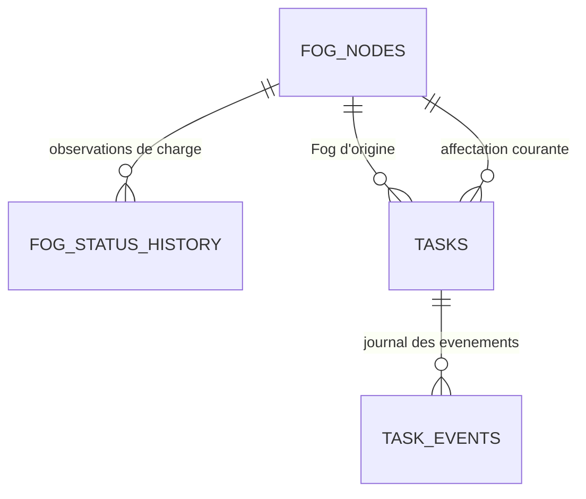

# MP3 - Checklist executable

Legende : P = priorite, E = effort estime. Cocher au fur et mesure, une tache = une branche courte.

| # | Tache | P | E | Definition de fini | Branche |
|---|---|---|---|---|---|
| T1 | Faire valider le contrat donnees par l equipe | P0 | 0,5 j | PR `chore(contracts)` approvee par MP1/MP2/MP4 | `chore/mp3/contract-freeze` |
| T2 | Environnement local (compose Postgres + Mosquitto + API) | P0 | 0,5 j | `docker compose up` puis `/healthz` = 200 | `feat/mp3/env` |
| T3 | 9 tables + Alembic + contraintes + index | P0 | 1 j | Migration et catalogue rejouables, tests PostgreSQL reussis ; partitionnement en T12 | `codex/mp3-schema` |
| T4 | Schemas Pydantic stricts (bornes, UTC, enums) | P0 | 0,5 j | fixtures invalides rejetees par `check_contract.py` | `feat/mp3/schemas` |
| T5 | Consommateur MQTT -> insertion | P0 | 1 j | `mosquitto_pub` => ligne en base | `feat/mp3/ingest-mqtt` |
| T6 | Deduplication par `message_id` + compteur | P0 | 0,5 j | 3 envois identiques = 1 ligne, metrique dup = 2 | `fix/mp3/dedup` |
| T7 | `POST /ingest/batch` (207 + erreurs indexes) | P1 | 1 j | reponse `{accepted,duplicates,rejected,errors[]}` | `feat/mp3/ingest-http` |
| T8 | Endpoints lecture + pagination + filtres + tri | P0 | 1,5 j | Swagger exploitable, page de 50 par defaut | `feat/mp3/read-api` |
| T9 | KPI pre-calculs + `/analytics/*` | P1 | 1,5 j | formules documentees, valeurs stables | `feat/mp3/kpis` |
| T10 | Publier `openapi.yaml` + mocks pour MP4 | P0 | 0,5 j | MP4 developpe sans attendre mon code | `docs/mp3/openapi` |
| T11 | Tests API + base + CI verte | P0 | 1 j | `pytest -q` vert depuis clone frais | `test/mp3/api` |
| T12 | Partitionnement, retention, batch writes, test de charge | P1 | 1,5 j | rapport avant/apres avec p95 et debit | `perf/mp3/load` |
| B1 | SSE `/stream` pour le temps reel | P2 | 0,5 j | MP4 recoit une alerte en < 1 s | `feat/mp3/sse` |
| B2 | `/metrics` Prometheus | P2 | 0,5 j | mes series visibles dans Grafana | `feat/mp3/metrics` |
| B3 | Seed scenarise | P2 | 0,5 j | `seed.py --scenario degradation --zone A` | `feat/mp3/seed` |
| B4 | Audit trail alertes (ack/resolve) | P2 | 0,5 j | historique immuable consultable | `feat/mp3/alert-lifecycle` |

Chemin critique : T1 -> T3 -> T4 -> T5 -> T6 -> T8 -> T11. Les autres sont paralleles.

## Etape 2 - base de donnees et collaboration Fog

Statut : **realisee et verifiee le 2 novembre 2026**. La base fog_cloud contient neuf tables
metier et alembic_version, revision `0001_mp3_schema`. Le catalogue contient trois Fog
et douze machines. Les sept tables de mesures / historiques / KPI restent vides jusqu'a
l'implementation de l'ingestion. Le detail du schema est dans
[DATABASE_SCHEMA.md](docs/DATABASE_SCHEMA.md).

- [x] 2.1 : schema conceptuel, champs actuels et extensions a convenir avec MP2 documentes.
- [x] 2.2 : neuf modeles, UUIDv4, bornes, references, index et origine connue immuable.
- [x] 2.3 : migration initiale generee, relue et appliquee ; upgrade head rejoue ; aucun drift.
- [x] 2.4 : initialisation executee deux fois ; seconde execution = zero ajout.
- [x] 2.5 : scenarios de partage, reprise, journal partiel, charge et doublons verifies en base jetable.
- [x] 2.6 : 79 tests reussis avec --postgres, Ruff valide, 11 fixtures conformes ; API machines lue.

La base jetable a ete supprimee apres les tests. Les trois Fog de catalogue restent OFFLINE,
sans heartbeat ni charge inventee. Leur execution sur trois environnements reels releve de MP2.

### Objectif et responsabilites

Construire une base permettant de repondre a quatre questions :

- Quels sont les trois Fog et quel est leur dernier etat observe ?
- Comment leur charge evolue-t-elle avant et apres un partage de taches ?
- Quel Fog est actuellement affecte a chaque tache ?
- Quels evenements expliquent une migration, une reprise ou un echec ?

MP2 execute les taches et decide de leur ordonnancement et de leurs transferts.
MP3 recoit les observations, conserve leur historique et prepare les donnees pour l'API
et les analyses. La collaboration peut reduire l'attente et la surcharge, mais son benefice
devra etre mesure en tenant compte des couts de transfert.

L'exigence de presentation reste trois environnements Fog distincts, actifs et
interconnectes. Les identifiants en base devront correspondre aux environnements reels
montres par MP2. Un catalogue ou des fixtures de test ne constituent pas cette demonstration.

### Schema retenu : neuf tables metier

Les sept tables du socle sont conservees :

- fog_nodes : registre et dernier etat observe de FOG_A, FOG_B et FOG_C.
- machines : catalogue des douze equipements et rattachement a leur zone et Fog d'origine.
- sensor_data : historique des mesures des machines.
- predictions : resultats d'analyse recus des Fog.
- alerts : alertes et cycle de traitement.
- task_events : journal des evenements des taches, a enrichir pour leur chronologie.
- kpi_records : resultats de calcul futurs, associes a une fenetre temporelle.

Deux tables supplementaires sont ajoutees :

- tasks : registre des taches observees et dernier etat connu. Il facilite les lectures
  de l'API sans recalculer l'ensemble du journal a chaque requete.
- fog_status_history : mesures successives de charge, files d'attente, etat et heartbeat.
  Elle conserve les observations qui seraient ecrasees dans fog_nodes.

Le registre tasks est une projection des observations, pas une file d'execution Cloud.
L'historique task_events reste la trace des changements de son etat.

### 2.1 - Definir les donnees et les contrats necessaires

Comprendre les entites, leurs relations et la distinction entre etat courant et historique.
Produire un schema lisible avec les champs et les liens avant de creer les tables.

Pour tasks, prevoir :

- task_id stable, type UUID conforme au contrat.
- task_type, priority et critical.
- origin_fog_id immuable et current_fog_id correspondant a la derniere affectation connue.
- machine_id facultatif pour les taches qui concernent une machine.
- status, created_at et dates connues de demarrage / fin.

Pour fog_status_history, prevoir :

- message_id unique et fog_id.
- observed_at, issu du last_heartbeat du producteur, et received_at cote Cloud.
- status, cpu_percent, ram_percent, queued_tasks et active_tasks.

Pour task_events, prevoir une date occurred_at propre a chaque evenement et une date
received_at cote Cloud. Le created_at du message actuel correspond a la creation de la
tache : il ne donne pas la date de chaque migration ou reprise.
Distinguer la source et la destination d'un transfert du Fog d'origine immuable de la tache.

Extensions a convenir avec MP2 lors de l'implementation :

- occurred_at et identification du Fog qui rapporte l'evenement.
- Identification d'une tentative d'execution et/ou sequence d'evenements pour gerer
  les reprises et les messages arrivant hors ordre.
- Cause structuree du transfert, par exemple surcharge ou panne, en complement de reason.
- machine_id facultatif et correspondance entre les Fog et leurs environnements reels.

Les futurs ajouts de champs devront etre accompagnes des schemas Pydantic, des fixtures et
des documents de contrat correspondants. Cette etape n'ajoute aucun champ obligatoire au
protocole. La regex UUIDv4 et les limites de 64 caracteres des identifiants d'alerte / versions
de modele sont explicitees dans les schemas et le contrat ; les fixtures existantes passent.
Pour les anciens messages sans date d'evenement, conserver l'information disponible et
marquer les mesures temporelles comme incompletes ; ne pas inventer une date de migration.
Les calculs entre plusieurs VM supposeront des horloges synchronisees.

Livrable : schema conceptuel et liste explicite des champs actuels / proposes.

### 2.2 - Aligner et fiabiliser les modeles SQLAlchemy

Adapter les modeles au schema retenu et verifier :

- message_id jusqu'a 64 caracteres, comme dans le contrat ; plusieurs colonnes actuelles
  sont limitees a 32 caracteres.
- Unicite du message_id pour la deduplication, sans rendre task_id unique dans task_events :
  une tache possede plusieurs evenements.
- Cles etrangeres vers les registres machines, fog_nodes et tasks.
- Conservation des references de source et destination des transferts.
- Timestamps avec fuseau horaire et convention UTC.
- Bornes de risque, CPU/RAM et compteurs non negatifs.
- Donnees de charge non encore observees distinguees d'une vraie mesure a zero.
- Index pour les lectures par machine/periode, Fog/periode, tache/chronologie et
  Fog affecte/statut de tache.

Commencer avec des tables non partitionnees et leurs index. Le partitionnement reste
un jalon de performance : PostgreSQL impose que les contraintes uniques d'une table
partitionnee incluent la cle de partitionnement. Une unicite globale de message_id ne
doit pas etre declaree telle quelle sur un partitionnement par timestamp.
Cette proposition precise donc le perimetre de T3 : schema et integrite d'abord ;
strategie de partitionnement et de deduplication compatible lors du travail de performance.

Livrable : modeles coherents et contraintes documentees.

### 2.3 - Creer la migration initiale Alembic

Faire charger a Alembic la meme configuration .env que l'API, puis generer et relire
la migration initiale. Verifier l'ordre de creation des tables et des cles etrangeres.
Executer la migration une fois le schema retenu, puis verifier une seconde execution
sans ajout ou modification inattendue.

Livrable : migration versionnee, neuf tables metier et table technique alembic_version.

### 2.4 - Initialiser les catalogues

Preparer un script d'initialisation idempotent :

- FOG_A, FOG_B et FOG_C, associes aux zones A, B et C.
- Machines M01 a M04 en A, M05 a M08 en B et M09 a M12 en C.
- Fog initialement non confirmes actifs : OFFLINE et last_heartbeat absent.
- Metadonnees d'environnement renseignees lorsqu'elles sont connues, sans inventer
  des adresses de VM ou des mesures de charge.

L'etat ONLINE devra ensuite provenir des observations des noeuds.
Executer le script deux fois devra toujours laisser trois Fog et douze machines.
Le script de catalogue est distinct de la generation de mesures de demonstration.

Livrable : catalogue reproductible et relations verifiees.

### 2.5 - Verifier le schema avec des scenarios de collaboration

Utiliser des donnees de test clairement identifiees pour verifier que le schema peut
representer :

1. Trois Fog observes en fonctionnement normal.
2. Une hausse de charge et de file d'attente sur FOG_A.
3. Une tache non critique transferee de FOG_A a FOG_B, puis executee et terminee.
4. Une tache critique qui reste sur son Fog lors de l'equilibrage de charge.
5. Une panne et une reprise sur un autre Fog, selon la politique definie par MP2.
6. Une nouvelle livraison du meme message qui ne cree pas un nouvel evenement.

Une tache conserve son task_id pendant tout son parcours. Chaque evenement distinct
possede son propre message_id. Les observations de charge avant et apres le transfert
restent disponibles, meme quand l'etat courant change.

Les tests de migration et de contraintes seront executes sur une base PostgreSQL de test
distincte, sans supprimer les donnees de fog_cloud. Un rollback de migration sera teste
uniquement dans cette base dediee.

Livrable : scenarios SQL et tests d'integrite / migration.

### 2.6 - Valider les livrables de l'etape 2

Criteres de fin :

- Neuf tables metier presentes et version Alembic connue.
- Trois Fog et douze machines correctement relies.
- Migration et initialisation rejouables.
- References inconnues et valeurs hors bornes rejetees.
- Un message reemis ne cree pas de doublon ; plusieurs evenements d'une meme tache
  sont conserves.
- Parcours d'une tache et evolution de charge d'un Fog consultables par requetes SQL.
- Champs manquants pour la mesure des performances explicitement identifies.
- Tests existants conserves et nouveaux tests PostgreSQL appropries reussis.

### Mesures preparees pour les etapes suivantes

La base devra fournir les donnees permettant de mesurer :

- Ecart de charge entre les trois Fog et evolution des files d'attente.
- Temps d'attente avant execution et duree d'execution, par tentative si necessaire.
- Nombre et cout temporel des transferts.
- Taux de reussite et d'echec des taches.
- Temps de reprise apres panne et disponibilite observee.

Le temps de reprise se mesure entre la detection de panne et la reprise effective ;
completed_at moins created_at mesure la duree globale d'une tache et ne suffit pas
a representer ce temps de reprise.
Un nombre eleve de migrations indique de l'activite de partage, mais ne mesure pas
une amelioration de performance.

La comparaison future portera sur les memes trois Fog, le meme volume et type de travail,
les memes ressources et des fenetres de test identifiees, avec et sans partage.
Les jobs KPI, la presentation dashboard et les mesures de performance sur les trois
environnements reels seront realises dans leurs jalons respectifs.

L'etape suivante a ce jalon etait l'etape 3, realisee ci-dessous. Les dates / sequences
de taches a convenir avec MP2 restent listees dans le schema.

## Etape 3 - service d'ecriture HTTP

Statut : **realisee et verifiee le 2 novembre 2026**. 114 tests reussis avec --postgres.
Les donnees de verification vivent uniquement dans les bases jetables des tests.

- [x] 3.1 : validation, bilan apres commit et erreurs metier definis.
- [x] 3.2 : ecriture des cinq messages via un service commun reutilisable par MQTT.
- [x] 3.3 : deduplication par type, comparaison de contenu, savepoint par message.
- [x] 3.4 : historique Fog atomique et protection contre les observations anciennes.
- [x] 3.5 : journal de taches, origine preservee, projections et chronologie incomplete explicites.
- [x] 3.6 : route HTTP branchee, doublons seuls 207, rejet total 422, transaction non confirmee 503.
- [x] 3.7 : tests HTTP/base/concurrence/rollback et documentation du pipeline.

Le guide est [HTTP_INGESTION.md](docs/HTTP_INGESTION.md). Les messages producteurs gardent
leurs champs actuels ; les ajouts de sequences et dates doivent etre convenus avec MP2.
La metrique Prometheus de doublons et la boucle MQTT sont realisees dans le jalon suivant.

L'etape suivante a ce jalon etait 4, realisee ci-dessous.

## Etape 4 - reception MQTT et reprise

Statut : **realisee et verifiee le 2 novembre 2026**. 149 tests reussis avec --mqtt,
Ruff valide et 11 fixtures conformes. Le guide est [MQTT_INGESTION.md](docs/MQTT_INGESTION.md).

- [x] 4.1 : cinq topics, payload brut et correspondance topic / identifiants valides.
- [x] 4.2 : client Paho 2, session persistante, identifiant stable, abonnements QoS 1 confirmes.
- [x] 4.3 : service commun persist_batch, ACK apres commit, doublon ou rejet definitif consigne.
- [x] 4.4 : retries temporaires sans ACK, reconnexion et protection des anciens numeros de paquet.
- [x] 4.5 : file bornee, limite de payload et pause de lecture pendant la saturation.
- [x] 4.6 : schema / catalogue verifies au demarrage, arret propre et metriques du worker.
- [x] 4.7 : volume Mosquitto persistant, image Docker construite, configuration Compose valide.
- [x] 4.8 : tests reels des cinq types, HTTP/MQTT, panne DB, commit sans ACK, session hors ligne,
  broker redemarre, heartbeat retenu, file pleine et trois publications = une ligne + deux doublons.
- [x] 4.9 : worker Docker healthy et ready=1, sauvegarde Mosquitto observee, API Windows
  accessible et base de travail inchangee ; aucun broker, volume ou base de test restant.

Les bases et brokers de test sont jetables. La base de travail conserve seulement les
catalogues : trois Fog OFFLINE sans heartbeat, douze machines et aucune observation de test.
La persistance du broker depend de ses sauvegardes ; les producteurs doivent conserver
leurs messages quand le broker est inaccessible. Les rejets ont des logs et compteurs,
sans quarantaine durable. Le timeout des heartbeats et les KPI ne sont pas implementes ici.

Prochaine etape : **5, completer les API de lecture utiles au dashboard**.
