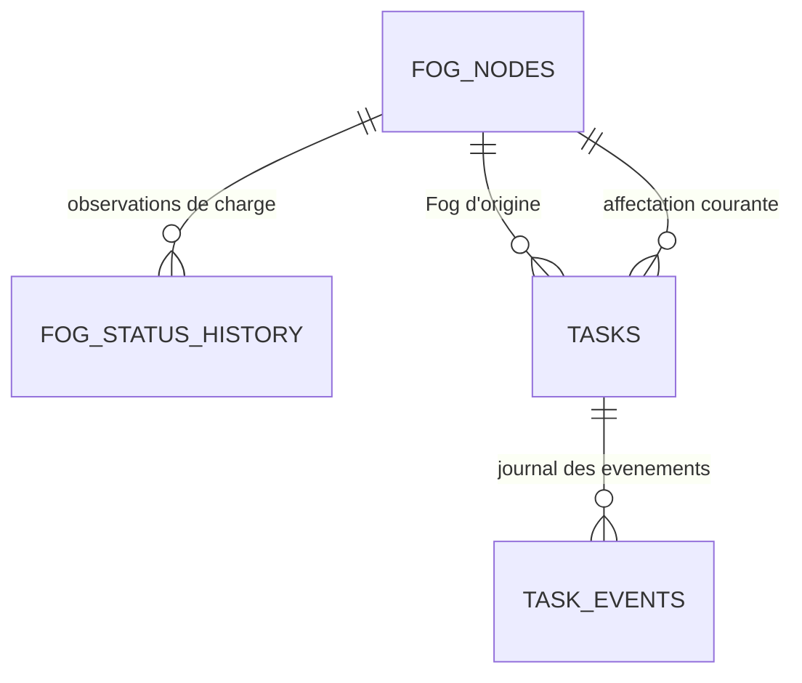

# MP3 - Checklist executable

Legende : P = priorite, E = effort estime. Cocher au fur et mesure, une tache = une branche courte.

| # | Tache | P | E | Definition de fini | Branche |
|---|---|---|---|---|---|
| T1 | Faire valider le contrat donnees par l equipe | P0 | 0,5 j | PR `chore(contracts)` approvee par MP1/MP2/MP4 | `chore/mp3/contract-freeze` |
| T2 | Environnement local (compose Postgres + Mosquitto + API) | P0 | 0,5 j | `docker compose up` puis `/healthz` = 200 | `feat/mp3/env` |
| T3 | 9 tables + Alembic + contraintes + index | P0 | 1 j | Migration et catalogue rejouables, tests PostgreSQL reussis ; partitionnement en T12 | `codex/mp3-schema` |
| T4 | Schemas Pydantic stricts (bornes, UTC, enums) | P0 | 0,5 j | fixtures invalides rejetees par `check_contract.py` | `feat/mp3/schemas` |
| T5 | Consommateur MQTT -> insertion | P0 | 1 j | `mosquitto_pub` => ligne en base | `feat/mp3/ingest-mqtt` |
| T6 | Deduplication par `message_id` + compteur | P0 | 0,5 j | 3 envois identiques = 1 ligne, metrique dup = 2 | `fix/mp3/dedup` |
| T7 | `POST /ingest/batch` (207 + erreurs indexes) | P1 | 1 j | reponse `{accepted,duplicates,rejected,errors[]}` | `feat/mp3/ingest-http` |
| T8 | Endpoints lecture + pagination + filtres + tri | P0 | 1,5 j | Swagger exploitable, page de 50 par defaut | `feat/mp3/read-api` |
| T9 | KPI pre-calculs + `/analytics/*` | P1 | 1,5 j | formules documentees, valeurs stables | `feat/mp3/kpis` |
| T10 | Publier `openapi.yaml` + mocks pour MP4 | P0 | 0,5 j | MP4 developpe sans attendre mon code | `docs/mp3/openapi` |
| T11 | Tests API + base + CI verte | P0 | 1 j | `pytest -q` vert depuis clone frais | `test/mp3/api` |
| T12 | Partitionnement, retention, batch writes, test de charge | P1 | 1,5 j | rapport avant/apres avec p95 et debit | `perf/mp3/load` |
| B1 | SSE `/stream` pour le temps reel | P2 | 0,5 j | MP4 recoit une alerte en < 1 s | `feat/mp3/sse` |
| B2 | `/metrics` Prometheus | P2 | 0,5 j | mes series visibles dans Grafana | `feat/mp3/metrics` |
| B3 | Seed scenarise | P2 | 0,5 j | `seed.py --scenario degradation --zone A` | `feat/mp3/seed` |
| B4 | Audit trail alertes (ack/resolve) | P2 | 0,5 j | historique immuable consultable | `feat/mp3/alert-lifecycle` |

Chemin critique : T1 -> T3 -> T4 -> T5 -> T6 -> T8 -> T11. Les autres sont paralleles.

## Etape 2 - base de donnees et collaboration Fog

Statut : **realisee et verifiee le 2 novembre 2026**. La base fog_cloud contient neuf tables
metier et alembic_version, revision `0001_mp3_schema`. Le catalogue contient trois Fog
et douze machines. Les sept tables de mesures / historiques / KPI restent vides jusqu'a
l'implementation de l'ingestion. Le detail du schema est dans
[DATABASE_SCHEMA.md](docs/DATABASE_SCHEMA.md).

- [x] 2.1 : schema conceptuel, champs actuels et extensions a convenir avec MP2 documentes.
- [x] 2.2 : neuf modeles, UUIDv4, bornes, references, index et origine connue immuable.
- [x] 2.3 : migration initiale generee, relue et appliquee ; upgrade head rejoue ; aucun drift.
- [x] 2.4 : initialisation executee deux fois ; seconde execution = zero ajout.
- [x] 2.5 : scenarios de partage, reprise, journal partiel, charge et doublons verifies en base jetable.
- [x] 2.6 : 79 tests reussis avec --postgres, Ruff valide, 11 fixtures conformes ; API machines lue.

La base jetable a ete supprimee apres les tests. Les trois Fog de catalogue restent OFFLINE,
sans heartbeat ni charge inventee. Leur execution sur trois environnements reels releve de MP2.

### Objectif et responsabilites

Construire une base permettant de repondre a quatre questions :

- Quels sont les trois Fog et quel est leur dernier etat observe ?
- Comment leur charge evolue-t-elle avant et apres un partage de taches ?
- Quel Fog est actuellement affecte a chaque tache ?
- Quels evenements expliquent une migration, une reprise ou un echec ?

MP2 execute les taches et decide de leur ordonnancement et de leurs transferts.
MP3 recoit les observations, conserve leur historique et prepare les donnees pour l'API
et les analyses. La collaboration peut reduire l'attente et la surcharge, mais son benefice
devra etre mesure en tenant compte des couts de transfert.

L'exigence de presentation reste trois environnements Fog distincts, actifs et
interconnectes. Les identifiants en base devront correspondre aux environnements reels
montres par MP2. Un catalogue ou des fixtures de test ne constituent pas cette demonstration.

### Schema retenu : neuf tables metier

Les sept tables du socle sont conservees :

- fog_nodes : registre et dernier etat observe de FOG_A, FOG_B et FOG_C.
- machines : catalogue des douze equipements et rattachement a leur zone et Fog d'origine.
- sensor_data : historique des mesures des machines.
- predictions : resultats d'analyse recus des Fog.
- alerts : alertes et cycle de traitement.
- task_events : journal des evenements des taches, a enrichir pour leur chronologie.
- kpi_records : resultats de calcul futurs, associes a une fenetre temporelle.

Deux tables supplementaires sont ajoutees :

- tasks : registre des taches observees et dernier etat connu. Il facilite les lectures
  de l'API sans recalculer l'ensemble du journal a chaque requete.
- fog_status_history : mesures successives de charge, files d'attente, etat et heartbeat.
  Elle conserve les observations qui seraient ecrasees dans fog_nodes.

Le registre tasks est une projection des observations, pas une file d'execution Cloud.
L'historique task_events reste la trace des changements de son etat.

### 2.1 - Definir les donnees et les contrats necessaires

Comprendre les entites, leurs relations et la distinction entre etat courant et historique.
Produire un schema lisible avec les champs et les liens avant de creer les tables.

Pour tasks, prevoir :

- task_id stable, type UUID conforme au contrat.
- task_type, priority et critical.
- origin_fog_id immuable et current_fog_id correspondant a la derniere affectation connue.
- machine_id facultatif pour les taches qui concernent une machine.
- status, created_at et dates connues de demarrage / fin.

Pour fog_status_history, prevoir :

- message_id unique et fog_id.
- observed_at, issu du last_heartbeat du producteur, et received_at cote Cloud.
- status, cpu_percent, ram_percent, queued_tasks et active_tasks.

Pour task_events, prevoir une date occurred_at propre a chaque evenement et une date
received_at cote Cloud. Le created_at du message actuel correspond a la creation de la
tache : il ne donne pas la date de chaque migration ou reprise.
Distinguer la source et la destination d'un transfert du Fog d'origine immuable de la tache.

Extensions a convenir avec MP2 lors de l'implementation :

- occurred_at et identification du Fog qui rapporte l'evenement.
- Identification d'une tentative d'execution et/ou sequence d'evenements pour gerer
  les reprises et les messages arrivant hors ordre.
- Cause structuree du transfert, par exemple surcharge ou panne, en complement de reason.
- machine_id facultatif et correspondance entre les Fog et leurs environnements reels.

Les futurs ajouts de champs devront etre accompagnes des schemas Pydantic, des fixtures et
des documents de contrat correspondants. Cette etape n'ajoute aucun champ obligatoire au
protocole. La regex UUIDv4 et les limites de 64 caracteres des identifiants d'alerte / versions
de modele sont explicitees dans les schemas et le contrat ; les fixtures existantes passent.
Pour les anciens messages sans date d'evenement, conserver l'information disponible et
marquer les mesures temporelles comme incompletes ; ne pas inventer une date de migration.
Les calculs entre plusieurs VM supposeront des horloges synchronisees.

Livrable : schema conceptuel et liste explicite des champs actuels / proposes.

### 2.2 - Aligner et fiabiliser les modeles SQLAlchemy

Adapter les modeles au schema retenu et verifier :

- message_id jusqu'a 64 caracteres, comme dans le contrat ; plusieurs colonnes actuelles
  sont limitees a 32 caracteres.
- Unicite du message_id pour la deduplication, sans rendre task_id unique dans task_events :
  une tache possede plusieurs evenements.
- Cles etrangeres vers les registres machines, fog_nodes et tasks.
- Conservation des references de source et destination des transferts.
- Timestamps avec fuseau horaire et convention UTC.
- Bornes de risque, CPU/RAM et compteurs non negatifs.
- Donnees de charge non encore observees distinguees d'une vraie mesure a zero.
- Index pour les lectures par machine/periode, Fog/periode, tache/chronologie et
  Fog affecte/statut de tache.

Commencer avec des tables non partitionnees et leurs index. Le partitionnement reste
un jalon de performance : PostgreSQL impose que les contraintes uniques d'une table
partitionnee incluent la cle de partitionnement. Une unicite globale de message_id ne
doit pas etre declaree telle quelle sur un partitionnement par timestamp.
Cette proposition precise donc le perimetre de T3 : schema et integrite d'abord ;
strategie de partitionnement et de deduplication compatible lors du travail de performance.

Livrable : modeles coherents et contraintes documentees.

### 2.3 - Creer la migration initiale Alembic

Faire charger a Alembic la meme configuration .env que l'API, puis generer et relire
la migration initiale. Verifier l'ordre de creation des tables et des cles etrangeres.
Executer la migration une fois le schema retenu, puis verifier une seconde execution
sans ajout ou modification inattendue.

Livrable : migration versionnee, neuf tables metier et table technique alembic_version.

### 2.4 - Initialiser les catalogues

Preparer un script d'initialisation idempotent :

- FOG_A, FOG_B et FOG_C, associes aux zones A, B et C.
- Machines M01 a M04 en A, M05 a M08 en B et M09 a M12 en C.
- Fog initialement non confirmes actifs : OFFLINE et last_heartbeat absent.
- Metadonnees d'environnement renseignees lorsqu'elles sont connues, sans inventer
  des adresses de VM ou des mesures de charge.

L'etat ONLINE devra ensuite provenir des observations des noeuds.
Executer le script deux fois devra toujours laisser trois Fog et douze machines.
Le script de catalogue est distinct de la generation de mesures de demonstration.

Livrable : catalogue reproductible et relations verifiees.

### 2.5 - Verifier le schema avec des scenarios de collaboration

Utiliser des donnees de test clairement identifiees pour verifier que le schema peut
representer :

1. Trois Fog observes en fonctionnement normal.
2. Une hausse de charge et de file d'attente sur FOG_A.
3. Une tache non critique transferee de FOG_A a FOG_B, puis executee et terminee.
4. Une tache critique qui reste sur son Fog lors de l'equilibrage de charge.
5. Une panne et une reprise sur un autre Fog, selon la politique definie par MP2.
6. Une nouvelle livraison du meme message qui ne cree pas un nouvel evenement.

Une tache conserve son task_id pendant tout son parcours. Chaque evenement distinct
possede son propre message_id. Les observations de charge avant et apres le transfert
restent disponibles, meme quand l'etat courant change.

Les tests de migration et de contraintes seront executes sur une base PostgreSQL de test
distincte, sans supprimer les donnees de fog_cloud. Un rollback de migration sera teste
uniquement dans cette base dediee.

Livrable : scenarios SQL et tests d'integrite / migration.

### 2.6 - Valider les livrables de l'etape 2

Criteres de fin :

- Neuf tables metier presentes et version Alembic connue.
- Trois Fog et douze machines correctement relies.
- Migration et initialisation rejouables.
- References inconnues et valeurs hors bornes rejetees.
- Un message reemis ne cree pas de doublon ; plusieurs evenements d'une meme tache
  sont conserves.
- Parcours d'une tache et evolution de charge d'un Fog consultables par requetes SQL.
- Champs manquants pour la mesure des performances explicitement identifies.
- Tests existants conserves et nouveaux tests PostgreSQL appropries reussis.

### Mesures preparees pour les etapes suivantes

La base devra fournir les donnees permettant de mesurer :

- Ecart de charge entre les trois Fog et evolution des files d'attente.
- Temps d'attente avant execution et duree d'execution, par tentative si necessaire.
- Nombre et cout temporel des transferts.
- Taux de reussite et d'echec des taches.
- Temps de reprise apres panne et disponibilite observee.

Le temps de reprise se mesure entre la detection de panne et la reprise effective ;
completed_at moins created_at mesure la duree globale d'une tache et ne suffit pas
a representer ce temps de reprise.
Un nombre eleve de migrations indique de l'activite de partage, mais ne mesure pas
une amelioration de performance.

La comparaison future portera sur les memes trois Fog, le meme volume et type de travail,
les memes ressources et des fenetres de test identifiees, avec et sans partage.
Les jobs KPI, la presentation dashboard et les mesures de performance sur les trois
environnements reels seront realises dans leurs jalons respectifs.

L'etape suivante a ce jalon etait l'etape 3, realisee ci-dessous. Les dates / sequences
de taches a convenir avec MP2 restent listees dans le schema.

## Etape 3 - service d'ecriture HTTP

Statut : **realisee et verifiee le 2 novembre 2026**. 114 tests reussis avec --postgres.
Les donnees de verification vivent uniquement dans les bases jetables des tests.

- [x] 3.1 : validation, bilan apres commit et erreurs metier definis.
- [x] 3.2 : ecriture des cinq messages via un service commun reutilisable par MQTT.
- [x] 3.3 : deduplication par type, comparaison de contenu, savepoint par message.
- [x] 3.4 : historique Fog atomique et protection contre les observations anciennes.
- [x] 3.5 : journal de taches, origine preservee, projections et chronologie incomplete explicites.
- [x] 3.6 : route HTTP branchee, doublons seuls 207, rejet total 422, transaction non confirmee 503.
- [x] 3.7 : tests HTTP/base/concurrence/rollback et documentation du pipeline.

Le guide est [HTTP_INGESTION.md](docs/HTTP_INGESTION.md). Les messages producteurs gardent
leurs champs actuels ; les ajouts de sequences et dates doivent etre convenus avec MP2.
La metrique Prometheus de doublons et la boucle MQTT sont realisees dans le jalon suivant.

L'etape suivante a ce jalon etait 4, realisee ci-dessous.

## Etape 4 - reception MQTT et reprise

Statut : **realisee et verifiee le 2 novembre 2026**. 149 tests reussis avec --mqtt,
Ruff valide et 11 fixtures conformes. Le guide est [MQTT_INGESTION.md](docs/MQTT_INGESTION.md).

- [x] 4.1 : cinq topics, payload brut et correspondance topic / identifiants valides.
- [x] 4.2 : client Paho 2, session persistante, identifiant stable, abonnements QoS 1 confirmes.
- [x] 4.3 : service commun persist_batch, ACK apres commit, doublon ou rejet definitif consigne.
- [x] 4.4 : retries temporaires sans ACK, reconnexion et protection des anciens numeros de paquet.
- [x] 4.5 : file bornee, limite de payload et pause de lecture pendant la saturation.
- [x] 4.6 : schema / catalogue verifies au demarrage, arret propre et metriques du worker.
- [x] 4.7 : volume Mosquitto persistant, image Docker construite, configuration Compose valide.
- [x] 4.8 : tests reels des cinq types, HTTP/MQTT, panne DB, commit sans ACK, session hors ligne,
  broker redemarre, heartbeat retenu, file pleine et trois publications = une ligne + deux doublons.
- [x] 4.9 : worker Docker healthy et ready=1, sauvegarde Mosquitto observee, API Windows
  accessible et base de travail inchangee ; aucun broker, volume ou base de test restant.

Les bases et brokers de test sont jetables. La base de travail conserve seulement les
catalogues : trois Fog OFFLINE sans heartbeat, douze machines et aucune observation de test.
La persistance du broker depend de ses sauvegardes ; les producteurs doivent conserver
leurs messages quand le broker est inaccessible. Les rejets ont des logs et compteurs,
sans quarantaine durable. Le timeout des heartbeats et les KPI ne sont pas implementes ici.

L'etape suivante a ce jalon etait 5, realisee ci-dessous.

## Etape 5 - lectures utiles au dashboard

Statut : **realisee et verifiee le 7 novembre 2026**. 247 tests reussis avec --mqtt,
Ruff valide, 11 fixtures conformes et contrat OpenAPI 3.0.3 valide et synchronise.
Les 149 tests precedents sont conserves ; 98 controles de lecture sont ajoutes.
Le guide de reference est [READ_API.md](docs/READ_API.md).

- [x] 5.1 : schemas de reponse explicites et conservation des valeurs inconnues NULL.
- [x] 5.2 : catalogue / derniere mesure et historique des mesures, departage des dates egales.
- [x] 5.3 : predictions par machine / zone / executant / modele / anomalie / periode.
- [x] 5.4 : alertes, filtres de cycle de vie et detail par alert_id.
- [x] 5.5 : etats Fog, age / staleness du heartbeat et historique des observations de charge.
- [x] 5.6 : projections des taches et journal, origine distincte de l'affectation, dates inconnues explicites.
- [x] 5.7 : huit collections paginees, limites 1-1000, tri autorise et erreurs 404 / 422 / 503 documentees.
- [x] 5.8 : lectures publiques conformes au code existant, ingestion protegee et Swagger Authorize.
- [x] 5.9 : contrat exportable / verifiable ; operations futures marquees planned.
- [x] 5.10 : tests PostgreSQL des filtres, pages, NULL, chronologies et ingestion HTTP lue depuis une autre connexion.
- [x] 5.11 : image API Python 3.12 construite, 13 lectures verifiees par HTTP et Swagger accessible.

Les lectures ne creent aucune observation ni transition persistante de panne. Les tests
utilisent des catalogues et observations synthetiques dans des bases / brokers jetables.
L'offset et le total restent soumis a l'ingestion concurrente ; aucune garantie de snapshot
multi-page n'est annoncee. Les schemas entrants et la revision Alembic restent inchanges.

L'etape 6 est realisee ci-dessous. L'acquittement d'alertes reste le jalon B4 ; la supervision
persistante des heartbeats, la retention et le partitionnement restent a venir.

## Etape 6 - KPI et agregats horaires

Statut : **realisee et verifiee le 7 novembre 2026**. 316 tests reussis avec --mqtt,
dont les 247 precedents et 69 controles analytics. Ruff, 11 fixtures, contrat OpenAPI
3.0.3 et Compose valides. Guide : [KPI_FORMULAS.md](docs/KPI_FORMULAS.md).

- [x] 6.1 : catalogue de 21 indicateurs observables, unites et dates source explicites.
- [x] 6.2 : sept indicateurs sans preuves exposes comme indisponibles, jamais comme zero.
- [x] 6.3 : heures UTC terminees [start, end), SQL GROUPING SETS et dimensions connues.
- [x] 6.4 : cache transactionnel dans kpi_records, idempotence, verrou et snapshot commun.
- [x] 6.5 : lookback borne, donnees tardives, refus de refresh hors retention et cache preserve.
- [x] 6.6 : migration 0002_kpi_scope sans nouvelle table, model_version jusqu'a 64 caracteres,
  index des receptions de taches et resolutions critiques, downgrade sans troncature.
- [x] 6.7 : quatre lectures paginees avec sample_size, quality, fraicheur et erreurs sures.
- [x] 6.8 : classement sur une heure, distributions par modele et heure sans precision inventee.
- [x] 6.9 : worker distinct, timeout, retries bornes, rollback sur erreur/arret et metriques 8002.
- [x] 6.10 : CLI une heure/periode explicite, contrat exporte et guide d'exploitation.
- [x] 6.11 : tests PostgreSQL numeriques, NULL, bornes, concurrence, rollback et migration.
- [x] 6.12 : images Docker Python 3.12 construites, quatre GET verifies HTTP, worker healthy.

Le demarrage Docker a montre l'attente du schema puis un refresh confirme : ready=1.
La base de travail garde 12 machines, 3 Fog et aucune observation synthetique. Un cache
vide est donc attendu et ne prouve pas la disponibilite des trois Fog reels.
La purge, le dimensionnement sous charge reelle et les preuves de gain restent a venir.
La supervision persistante des heartbeats est realisee ci-dessous.

## Etape 7 - supervision persistante des heartbeats

Statut : **realisee et verifiee le 7 novembre 2026**. 364 tests reussis avec --mqtt,
dont les 316 precedents et 48 controles supplementaires. Ruff, 11 fixtures,
OpenAPI 3.0.3 et Compose valides. Guide : [FOG_SUPERVISION.md](docs/FOG_SUPERVISION.md).

- [x] 7.1 : etats Cloud UNKNOWN / REACHABLE / UNREACHABLE distincts du statut rapporte.
- [x] 7.2 : dates producteur et reception fraiches, anciens messages et doublons sans fausse reprise.
- [x] 7.3 : horloges futures inconnues, correction fraiche possible, dates retrogrades protegees.
- [x] 7.4 : transitions, preuves et lacunes MONITOR_GAP conservees dans fog_status_history.
- [x] 7.5 : migration 0003 avec neuf tables, sources distinguees par CHECK et downgrade sans perte.
- [x] 7.6 : transaction, verrous communs a l'ingestion, timeout, rollback et idempotence concurrente.
- [x] 7.7 : journal public pagine, filtres / periodes, fraicheur et etat effectif des lectures.
- [x] 7.8 : worker distinct, retries / arret partages avec analytics, metriques et healthcheck 8003.
- [x] 7.9 : tests PostgreSQL de pertes, reprises, concurrence, panne transactionnelle et schema HTTP.
- [x] 7.10 : images Python 3.12 construites ; supervision, analytics et ingestion healthy.

La base conserve 12 machines et trois Fog UNKNOWN sans heartbeat, sans observation
synthetique ni transition de panne inventee. Une verification UNKNOWN est confirmee
periodiquement ; les donnees producteurs ne sont pas simulees. Une perte courte entre
scans peut echapper au journal. La disponibilite reelle reste un indicateur indisponible.
La retention est realisee ci-dessous, avec preservation de la deduplication,
des alertes a resoudre et des preuves utiles aux KPI / chronologies.

## Etape 8 - retention des mesures et predictions

Statut : **realisee et verifiee le 7 novembre 2026**. 385 tests reussis avec --mqtt,
dont les 364 precedents et 21 controles de retention ; puis 27 controles PostgreSQL
apres la protection finale du cache. Ruff, 11 fixtures, OpenAPI et Compose valides.
Guide : [RETENTION.md](docs/RETENTION.md).

- [x] 8.1 : seuil RAW_RETENTION_DAYS, heures entierement expirees et lots bornes.
- [x] 8.2 : simulation par defaut, CLI review/apply et activation periodique configurable.
- [x] 8.3 : registre compact technique ingest_receipts, neuf tables metier toujours presentes.
- [x] 8.4 : empreintes semantiques sans arrondi, reservation transactionnelle et ancien brut equipe avant purge.
- [x] 8.5 : doublons/conflits apres suppression, nouveaux identifiants d'heures closes refuses.
- [x] 8.6 : quinze agregrats de mesures/predictions finalises avant suppression ; marque interne non exposee.
- [x] 8.7 : cache preserve sur lots multiples, refresh d'heure finalisee refuse et dernier capteur conserve.
- [x] 8.8 : alertes, taches, historique Fog et preuves de supervision conserves.
- [x] 8.9 : barriere partagee d'ingestion, cycle exclusif non bloquant, timeout/rollback et reprise.
- [x] 8.10 : migration 0004 avec refus de downgrade perdant la deduplication ; tests de concurrence/purge.
- [x] 8.11 : images Python 3.12 construites, retention et autres workers healthy, metriques 8004.

La base de travail conserve ses catalogues sans observation synthetique. Retention
est active en simulation (candidats=0, suppression=0), avec onze tables PostgreSQL :
neuf metier et deux techniques. Le registre de clefs et les historiques conserves
croissent encore ; aucun partitionnement ni restauration de backup n'est annonce.
Prochaine etape : **mesurer performances et contention**, puis definir les optimisations
ou le partitionnement compatibles avec les garanties de deduplication et le cache.

## Etape 9 - baseline A/B/C, performance et contention Fog

Statut : **baseline realisee et correction ciblee verifiee le 7 novembre 2026**.
388 tests reussis avec --mqtt ; trois scenarios longs ignores par defaut et verifies
avec --performance. Le scenario mixte est repete apres la correction de verrou.
Les repetitions de controle ne constituent pas de nouveaux tests distincts.
Guide et resultats : [PERFORMANCE.md](docs/PERFORMANCE.md).

- [x] 9.1 : abonnements + documentes pour A/B/C, catalogue de douze machines et topic commun tasks/events.
- [x] 9.2 : parcours trois zones MQTT->commit->API, transferts A->B->C->A, supervision B et rejeux.
- [x] 9.3 : HTTP TCP loopback et bases/broker jetables, meme volume pour lots 1/100, warmup explicite.
- [x] 9.4 : debit, distributions par route, lectures seules/concurrentes, trois clients MQTT et jobs.
- [x] 9.5 : purge isolee de 264 observations, KPI conserves et deduplication apres suppression.
- [x] 9.6 : rapports JSON locaux ignores par Git, effectifs/conditions/limites et plan EXPLAIN conserves.
- [x] 9.7 : contention FOR UPDATE/FK reproduite par test ; FOR NO KEY UPDATE commun aux etats Fog.
- [x] 9.8 : progression scan/heartbeat avec prediction non commitee et serialisation des mises a jour.
- [x] 9.9 : comparaison avant/apres, Ruff/OpenAPI/fixtures/Compose valides, documentation verifiee.
- [x] 9.10 : cinq images Python 3.12 reconstruites, quatre workers healthy/ready=1 et API accessible.

HTTP unitaire : 44,2 messages/s ; lots de 100 : 109,2 messages/s sur 2400 mesures.
Maximum de scan Fog observe : 6881,7 -> 251,0 ms apres correction, avec deux essais
locaux distincts. Le p95 combine des lectures sous charge reste environ 234 ms,
et la latence MQTT en rafale depasse la cible. Le gain de supervision ne prouve
pas une amelioration generale de debit ou de lecture.

La base fog_cloud conserve seulement les 12 machines et trois Fog, sans observation
synthetique ; retention reste en simulation. Les ressources de test sont supprimees.
Les modifications restent locales, non commitees/non poussees.

T12 reste partiellement realise : aucun partitionnement ni dimensionnement sur
plusieurs jours. La prochaine mesure doit separer les processus du generateur/API,
utiliser une charge cadensee et profiler reseau/driver/SQL/verrous avant d'optimiser
les lectures ou l'ingestion. Ensuite, preparer CI et livraison pour MP2/MP4 ; la
demonstration des trois environnements Fog reels reste a valider avec MP2.

## Etape 10 - laboratoire cadense et essais autonomes

Statut : **realisee et verifiee le 8 novembre 2026**. Suite complete --mqtt :
399 tests reussis, trois anciens benchmarks longs ignores par defaut ; puis 37
controles MQTT/laboratoire reussis apres le dernier garde-fou de ports. Les
repetitions ne sont pas de nouveaux tests distincts. Ruff, 11 fixtures, OpenAPI
et les deux configurations Compose valides. Tutoriel : [LAB_ETAPE10.md](docs/LAB_ETAPE10.md).

- [x] 10.1 : base fog_lab, volumes/projet Compose dedies et ports loopback 8100/1884.
- [x] 10.2 : generateur Windows distinct des cinq processus backend Docker.
- [x] 10.3 : 12 machines A/B/C a cadence fixe, predictions, heartbeats, alertes et taches.
- [x] 10.4 : six GET concurrents par refresh ; retards et echeances manquees conserves.
- [x] 10.5 : comptages SQL par run, doublons HTTP, delai de vidage borne et rapports incomplets.
- [x] 10.6 : p95/p99 selon effectifs ; p95 MQTT en intervalle de bucket, horloges distinguees.
- [x] 10.7 : historique de preparation, KPI/supervision/retention aux intervalles normaux.
- [x] 10.8 : plafond reseau observe a 5 Hz ; poll non bloquant et pause a vide/saturation.
- [x] 10.9 : ACK apres commit, file bornee et reprise conserves ; regression MQTT verifiee.
- [x] 10.10 : CLI start/run/status/logs/sql/stop ; namespace, proprietaire et ports controles.
- [x] 10.11 : commandes et exercices documentes, stop/start verifies sans toucher fog_cloud.
- [x] 10.12 : commande debutant 60 s/1 Hz verifiee apres les garde-fous : 840 messages, cadence valide.
- [x] 10.13 : chevauchement de deux runs utilisateurs identifie par rapports et SQL ; verrou OS
  interprocessus pour start/run/stop, lectures autorisees et liberation apres crash.
- [x] 10.14 : pause de vidage avant baseline, reset/surplus de confirmations et histogramme
  contamine refuses ; interruption et raison d'echec conservees dans le rapport.

Correction du chevauchement : 44 controles MQTT/laboratoire reussis et Ruff valide.
Les regressions utilisent un vrai second processus, un crash du detenteur et un
appel CLI bloque avant toute lecture de state.json. Deux essais consecutifs de
controle (20 s a 1 Hz, 10 s a 5 Hz) confirment respectivement 288 et 630 messages
en SQL. Les donnees utilisateur sont conservees ; les controles ajoutent leurs
propres observations, identifiables par run_id. Pas de modification du worker metier.

Essai corrige de 120 s a 5 Hz : 7428/7428 messages confirmes en 120,13 s, cadence
valide, aucun rejet MQTT ni erreur HTTP. P95 HTTP combine 69,7 ms ; historique M01
56,9 ms sur 120 lectures ; MQTT moyen 42,7 ms, p95 (75,100] ms sur 7428 messages.
Deux cycles KPI, 24 scans de supervision, retention un succes/quatre busy sans
erreur ; les 36 observations expirees sont supprimees. Les essais 5 Hz precedents
restent marques incomplets. Methode et limites : [PERFORMANCE.md](docs/PERFORMANCE.md).

La base de travail conserve ses catalogues sans observations synthetiques ; sa
retention reste en simulation. Les cinq images de travail sont reconstruites avec
la correction MQTT. Le laboratoire est distinct et peut rester actif pour les
essais personnels. Les changements restent locaux, non commites/non pousses.

T12 reste partiel : pas de partitionnement ni dimensionnement sur plusieurs jours.
Prochaine etape : reproduire soi-meme le laboratoire, puis preparer CI et lancement
depuis un clone frais avant la validation des programmes reels MP2/MP4.
