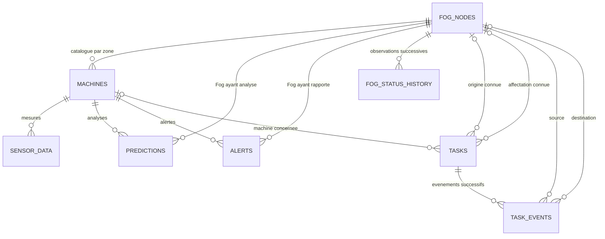

# Etape 2 - schema PostgreSQL de MP3

MP3 conserve les donnees recues des Fog. Les decisions d'ordonnancement, de transfert
et de reprise sont prises par MP2. Le schema contient neuf tables metier ;
Deux tables techniques completent les neuf tables metier : alembic_version (migrations)
et ingest_receipts (preuves de deduplication des mesures/predictions apres retention),
soit onze tables visibles dans PostgreSQL depuis la migration 0004.

## Relations a comprendre



`kpi_records` conserve les resultats agreges par nom de metrique, perimetre et fenetre.
Un KPI peut combiner plusieurs tables et n'est donc pas rattache a une seule ligne source.

## Les neuf tables

### 1. fog_nodes - catalogue et dernier etat observe

- Cle primaire `fog_id` : FOG_A, FOG_B ou FOG_C ; `zone` correspond a A, B ou C.
- `status`, `cpu_percent`, `ram_percent`, `queued_tasks`, `active_tasks` : dernier etat connu.
- `last_heartbeat` : date du producteur ; `last_received_at` : reception de cette observation.
- `offline_since`, `recovered_at` : dates de changement rapporte par MP2, alimentees lors de l'ingestion.
- `supervision_status`, `supervision_reason`, `supervision_since`, `supervision_checked_at` :
  decisions distinctes du superviseur Cloud (migration 0003_fog_supervision).
- `environment_ref`, `endpoint` : references facultatives de l'environnement reel MP2.
- `registered_at` : date d'inscription au catalogue, distincte d'un heartbeat.

L'initialisation donne OFFLINE et laisse les mesures / dates d'observation a NULL.
Cela signifie que l'activite n'a pas encore ete confirmee. Une mesure NULL differe d'une
vraie mesure a zero. La creation de ces entrees ne demarre aucun environnement Fog.

### 2. machines - catalogue des douze equipements

- Cle primaire `machine_id` : M01 a M12 ; `name`, `machine_type` : metadonnees.
- `zone`, `fog_id` : zone et Fog du catalogue, verifies ensemble par une cle etrangere.
- `installed_at` : date physique d'installation, inconnue au depart ; `registered_at` : inscription.

Initialisation : M01-M04 en A / FOG_A, M05-M08 en B / FOG_B, M09-M12 en C / FOG_C.
Les noms initiaux sont `Machine Mxx`, les types `UNSPECIFIED` : les vrais types et dates
seront renseignes quand ils seront connus. Le script ne remplace aucune entree existante.

### 3. sensor_data - historique des mesures

- Cle primaire technique `id` de type BIGINT ; `message_id` unique pour ce type de message.
- `machine_id`, `zone` : cle etrangere composee garantissant la zone de la machine.
- `timestamp` : date de mesure ; `received_at` : date de reception Cloud.
- `temperature`, `vibration`, `speed`, `current`, `pressure`, `power`, `frequency`, `state`.

Les bornes et etats du contrat sont aussi controles en base. Les trois mesures
optionnelles peuvent rester NULL. Deux messages distincts peuvent avoir la meme date.

### 4. predictions - resultats d'analyse recus

- `id`, `message_id` unique, references `machine_id` et `fog_id`.
- `timestamp`, `received_at`, `risk_score`, `anomaly`, `predicted_fault`, `severity`, `model_version`.

`risk_score` est un NUMERIC sans arrondi impose a trois decimales, borne entre 0 et 1.
Le Fog qui a execute l'analyse peut differer du Fog de catalogue de la machine : c'est
necessaire lorsqu'une tache est partagee. `model_version` comporte 1 a 64 caracteres.

### 5. alerts - alertes et traitement

- `id`, `message_id` unique et `alert_id` unique (1 a 64 caracteres).
- References machine / Fog, `timestamp`, `received_at`, `type`, `severity`, `message`,
  `recommended_action` facultatif.
- `status` : OPEN, ACKNOWLEDGED ou RESOLVED ; `acknowledged_at`, `acknowledged_by`, `resolved_at`.

La base refuse les dates d'acquittement / resolution anterieures a l'alerte et une
resolution anterieure a un acquittement connu. Le service de gestion viendra dans l'etape API.

### 6. fog_status_history - observations MP2 et decisions Cloud

- `id`, `message_id` unique, references `fog_id` / `zone`.
- `record_type=HEARTBEAT` : observed_at = last_heartbeat producteur, received_at = reception,
  status / cpu_percent / ram_percent / queued_tasks / active_tasks obligatoires.
- `record_type=SUPERVISION` : observed_at et received_at Cloud, statut/charges MP2 NULL,
  supervision_status / previous_supervision_status / supervision_reason, preuves temporelles,
  timeout_seconds et dates gap_start/gap_end pour les lacunes de couverture.

Chaque observation reste stockee lorsque `fog_nodes` change. Cette histoire permet de
comparer les charges et files d'attente avant / apres un transfert. CPU et RAM sont
bornes a 0-100 ; les compteurs sont entiers et non negatifs.

### 7. tasks - dernier etat observe des taches

- Cle primaire `task_id` : UUIDv4 stable ; `task_type`, `priority`, `critical`, `status`.
- `origin_fog_id` : origine connue, a conserver apres les transferts.
- `current_fog_id` : derniere affectation connue ; `machine_id` facultatif.
- `created_at` : creation de la tache ; `started_at`, `completed_at` : dates connues.
- `last_event_at` : date connue du dernier evenement ; `last_received_at` : reception Cloud.

Ce registre facilite les lectures ; il n'est pas une file d'execution Cloud. Si les
premiers evenements manquent, l'origine reste NULL. La source d'une migration tardive
ne suffit pas a retrouver cette origine. L'affectation reste NULL lorsqu'elle est inconnue.
Une origine NULL peut etre completee ; une fois connue, elle ne peut plus etre modifiee
ni effacee. Un trigger PostgreSQL, versionne dans la migration, protege cette regle.
Les dates de demarrage / fin ne decrivent pas toutes les tentatives de reprise.

### 8. task_events - journal du parcours d'une tache

- `id`, `message_id` unique ; `task_id` est une cle etrangere, sans contrainte d'unicite.
- `task_type`, `priority`, `critical`, `status` : valeurs rapportees dans cet evenement.
- `source_fog`, `destination_fog` facultatif : source et destination de cet evenement.
- `created_at` : creation de la tache ; `completed_at` facultatif : fin connue.
- `occurred_at` facultatif : date propre a l'evenement ; `received_at` : reception Cloud.
- `reason` : explication libre facultative.

Une tache A -> B -> C conserve son `task_id` et son origine A. Chaque evenement porte un
nouveau `message_id`. Une retransmission du meme evenement utilise le meme `message_id`.

Le contrat entrant actuel n'envoie pas `occurred_at`. La colonne est preparee mais reste
NULL pour ces messages ; aucune date de migration n'est inventee a partir de `created_at`
ou de l'heure de reception. Les nouveaux champs du protocole restent a convenir avec MP2.

### 9. kpi_records - resultats agreges

- `id`, `metric`, `scope`, `scope_value`, `bucket_start`, `bucket_end`, `value`, `sample_size`,
  `computed_at`.
- Unicite de `(metric, scope, scope_value, bucket_start)` pour un recalcul idempotent.
- Fenetre de duree positive, taille d'echantillon non negative et valeur numerique finie.

Les calculs seront implementes dans l'etape KPI ; la table reste vide a l'initialisation.

## Integrite et index

Les identifiants de message contiennent 8 a 64 caracteres. Leur unicite est verifiee dans
chaque table de messages, donc par type. Les catalogues / projections n'ont pas de
`message_id`. Le futur service d'ingestion traduira les conflits en compteur `duplicates`.

Les cles etrangeres empechent les references inconnues et la suppression d'un catalogue
encore reference. La coherence machine / zone et Fog / zone est verifiee en base.
Les colonnes de date utilisent `timestamptz` ; l'entree / sortie applicative utilise UTC.

Les index visent machine / periode, Fog / periode, affectation / statut et tache /
chronologie. `occurred_at` peut manquer : l'index tache / reception permet alors de lire
l'ordre d'arrivee, qui ne constitue pas une preuve de l'ordre reel des evenements.

Le schema ne force pas la localite de toutes les taches critiques. MP2 doit conserver
les traitements critiques locaux lors de l'equilibrage ; sa politique de reprise apres
panne peut permettre un autre Fog. Le Cloud doit pouvoir enregistrer les deux cas.

Les tables ne sont pas partitionnees a cette etape. Une future strategie de partitionnement
devra preserver la deduplication : PostgreSQL exige que les cles uniques d'une table
partitionnee incluent la cle de partitionnement.

## Contrats et mesures a completer avec MP2

La validation UUIDv4 corrige l'ancienne regex qui acceptait toutes les versions UUID.
Les limites existantes en base (64) de `alert_id` et `model_version` sont maintenant
explicites dans la validation et dans DATA_CONTRACT.md. Les fixtures actuelles restent valides.
Aucun nouveau champ obligatoire n'est ajoute aux messages.

Avant l'implementation de l'ingestion des taches, convenir des extensions suivantes :

- `occurred_at` : date UTC de chaque evenement ; identification du Fog rapporteur.
- Identifiant de tentative d'execution et sequence pour les reprises / arrivees hors ordre.
- Cause structuree du transfert : surcharge, panne ou autre decision.
- Origine explicite si un evenement de creation n'est pas disponible ; machine concernee.
- Dates de detection de panne et de reprise effective pour mesurer le temps de reprise.

Les colonnes / champs de ces extensions autres que `occurred_at` ne sont pas encore crees.
Une future modification du contrat doit mettre a jour validation, fixtures et migration.
Les horloges des trois environnements Fog devront etre synchronisees. Le gain du partage
sera mesure sur des charges equivalentes, avec et sans partage, en incluant le cout des transferts.

## Execution depuis PowerShell

Depuis `C:\Users\User\Desktop\FOG\mp3-cloud`, avec PostgreSQL actif :

```powershell
.\.venv\Scripts\python.exe -m alembic upgrade head
.\.venv\Scripts\python.exe -m scripts.init_catalogue
.\.venv\Scripts\python.exe -m scripts.init_catalogue
.\.venv\Scripts\python.exe -m alembic current
.\.venv\Scripts\python.exe -m alembic check
.\.venv\Scripts\python.exe -m pytest --postgres
```

Alembic charge la meme configuration que l'API : environnement, puis `.env`, puis valeurs
par defaut. Le script insere seulement les entrees absentes, dans une seule transaction.
La seconde initialisation doit annoncer zero ajout.

Les tests `--postgres` creent une base `mp3_test_<UUID>` distincte sur ce serveur, appliquent
les migrations, verifient les contraintes / scenarios, puis suppriment uniquement cette base.
Le compte doit pouvoir creer une base de test. Sans `--postgres`, ces tests sont ignores.
La migration descendante est testee uniquement dans la base jetable.

## Requetes de lecture pour comprendre

Catalogue et affectations des machines :

```sql
SELECT machine_id, zone, fog_id FROM machines ORDER BY machine_id;
SELECT fog_id, status, cpu_percent, last_heartbeat FROM fog_nodes ORDER BY fog_id;
```

Evolution de charge et parcours d'une tache, une fois les observations ingerees :

```sql
SELECT observed_at, status, cpu_percent, queued_tasks
FROM fog_status_history WHERE fog_id = 'FOG_A'
ORDER BY observed_at, id;

SELECT task_id, origin_fog_id, current_fog_id, status FROM tasks;
SELECT task_id, status, source_fog, destination_fog, occurred_at, received_at
FROM task_events
ORDER BY task_id, occurred_at NULLS LAST, received_at, id;
```

L'etape 2 cree le schema et le catalogue. L'etape 3 realise le service d'ecriture HTTP
et les projections automatiques : voir [HTTP_INGESTION.md](HTTP_INGESTION.md).
L'etape 4 branche le worker MQTT sur ce meme service : voir [MQTT_INGESTION.md](MQTT_INGESTION.md).
L'etape 6 calcule les KPI dans kpi_records : voir [KPI_FORMULAS.md](KPI_FORMULAS.md).
La migration 0002_kpi_scope elargit scope_value a 64 caracteres et indexe les receptions
de taches et les resolutions critiques. Elle conserve les neuf tables metier.
La supervision temporelle est realisee a l'etape 7 : voir [FOG_SUPERVISION.md](FOG_SUPERVISION.md).
La migration 0003_fog_supervision reutilise les tables, avec separation des sources par CHECK.
La retention des mesures/predictions est realisee a l'etape 8 : voir [RETENTION.md](RETENTION.md).
Le registre technique ingest_receipts conserve kind/message_id et empreinte binaire.
Alertes, taches et preuves de supervision restent conservees ; simulation active par defaut.
